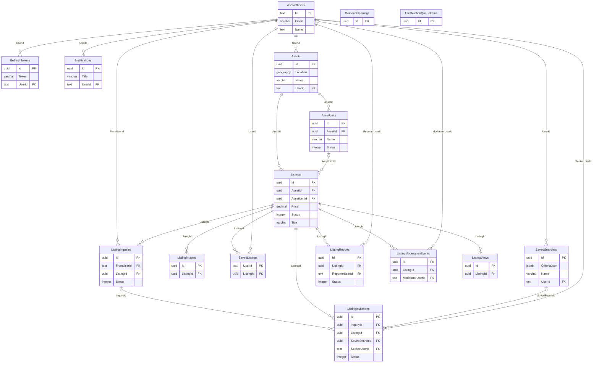

# Phân tích và thiết kế cơ sở dữ liệu KGS

> Tài liệu này **được sinh tự động** từ `kgs-api/kgs-api/Migrations/ApplicationDbContextModelSnapshot.cs` — tức là từ chính mô hình EF Core đang tạo ra CSDL — nên kiểu dữ liệu, khoá, chỉ mục và ràng buộc luôn khớp với hệ thống thật. Các hình tương ứng nằm trong `SoDo_KGS_VoHoangTuan_v4.drawio` (Hình 2.20a, 2.20, Bảng 2.y1 → 2.y6). Giải thích chung của toàn hệ thống: [thiet-ke-he-thong.md](thiet-ke-he-thong.md).

## 1. Quy trình thiết kế ba mức

| Mức | Câu hỏi trả lời | Sản phẩm | Hình |
|---|---|---|---|
| Khái niệm | Hệ thống cần nhớ **những gì**, chúng liên quan ra sao? | Thực thể nghiệp vụ + mối kết hợp + bản số | 2.20a |
| Logic | Tổ chức thành **những bảng** nào, khoá gì, nối ra sao? | ERD chân chim, lược đồ quan hệ, chuẩn hoá | 2.20, Bảng 2.y1 |
| Vật lý | Trên **PostgreSQL** cụ thể thế nào? | Kiểu dữ liệu, NULL, chỉ mục, CHECK, quy tắc xoá | Bảng 2.y2 → 2.y6 |

Đi từ mô hình lớp lĩnh vực (Hình 2.5, 2.6): mỗi lớp thực thể → một bảng; value object (`Address`, `ListingTerms`, `StoredFile`) → nhóm cột nhúng trong bảng chủ; quan hệ N–M «lưu tin» → bảng kết hợp `SavedListings`.

## 2. Mô hình khái niệm

| Thực thể | Ý nghĩa | Bảng |
|---|---|---|
| Người dùng | Tài khoản, mang các vai Khách/Người tìm/Người đăng/Quản trị | `AspNetUsers` |
| Phiên đăng nhập | Refresh token, xoay vòng mỗi lần làm mới | `RefreshTokens` |
| Thông báo | Tin báo trong chuông và email | `Notifications` |
| Nhu cầu (bộ lọc đã lưu) | Tiêu chí tìm; khi mở cho chủ nhà thì là nhu cầu | `SavedSearches` |
| Lần mở nhu cầu | Nhật ký để giới hạn đăng dày | `DemandOpenings` |
| Tài sản | Bất động sản thật | `Assets` |
| Căn / phòng | Đơn vị trong toà nhà | `AssetUnits` |
| Tin đăng | Một lần rao tài sản hoặc căn | `Listings` |
| Ảnh tin | Ảnh của tin | `ListingImages` |
| Yêu cầu xem nhà | Người tìm hỏi chủ tin | `ListingInquiries` |
| Lời mời | Chủ tin mời một nhu cầu | `ListingInvitations` |
| Báo vi phạm | Người dùng báo tin xấu | `ListingReports` |
| Sự kiện kiểm duyệt | Lịch sử duyệt tin | `ListingModerationEvents` |
| Lượt xem | Lượt xem đã khử trùng | `ListingViews` |

**Mối kết hợp chính và bản số:** Người dùng 1–N Tài sản · Tài sản 1–N Căn · Tài sản 1–N Tin đăng · Căn 0..1–N Tin đăng · Tin đăng 1–N Ảnh (≤ 20) · Người dùng M–N Tin đăng («lưu») · Người dùng 1–N Nhu cầu (≤ 20) · Tin đăng 1–N Lời mời · Nhu cầu 0..1–N Lời mời · Lời mời 0..1–0..1 Yêu cầu xem nhà · Người dùng 1–N Yêu cầu · Tin đăng 1–N Yêu cầu · Tin đăng 1–N Báo vi phạm · Tin đăng 1–N Sự kiện kiểm duyệt · Tin đăng 1–N Lượt xem · Người dùng 1–N Thông báo.

## 3. Mô hình logic

### 3.1 Sơ đồ thực thể – liên kết (khoá và quan hệ)

`DemandOpenings` và `FileDeletionQueueItems` không có khoá ngoại — có chủ ý: dòng nhật ký phải sống sót sau khi nhu cầu/ảnh bị xoá.

### 3.2 Lược đồ quan hệ

Ký hiệu: **gạch chân** = khoá chính, `#` = khoá ngoại.

- **AspNetUsers**(<u>Id</u>, AdminLockReason, AdminLockedAt, AdminLockedByUserId, AvatarUrl, Bio, CreatedAt, Email, EmailConfirmed, Name, PasswordHash, PhoneNumber, UserName)
- **RefreshTokens**(<u>Id</u>, CreatedAt, CreatedBy, CreatedByIp, ExpiresAt, ReplacedByToken, RevokedAt, Token, UpdatedAt, UpdatedBy, #UserId)
- **Notifications**(<u>Id</u>, Body, CreatedAt, CreatedBy, LinkLabel, LinkPath, ReadAt, Title, UpdatedAt, UpdatedBy, #UserId)
- **SavedSearches**(<u>Id</u>, CreatedAt, CreatedBy, CriteriaJson, DemandNote, DemandReview, DemandReviewReason, DemandReviewedAt, DiscoverableByOwners, DiscoverableSince, DiscoverableUntil, ExpiryRemindedAt, LastCheckedAt, LastNotifiedAt, Name, NotifyEnabled, UpdatedAt, UpdatedBy, #UserId)
- **DemandOpenings**(<u>Id</u>, OpenedAt, SavedSearchId, UserId)
- **Assets**(<u>Id</u>, Area, Bathrooms, Bedrooms, BuildingModelPublished, CreatedAt, CreatedBy, FloorHeightMeters, Floors, FootprintJson, Frontage, FurnitureState, HouseDirection, LegalStatus, Location, Name, Notes, TypeProperty, UpdatedAt, UpdatedBy, #UserId, City, AddressDetail, District, NewProvince, NewProvinceCode, NewWard, NewWardCode, Ward)
- **AssetUnits**(<u>Id</u>, Area, #AssetId, CreatedAt, CreatedBy, FloorNumber, Name, Notes, Status, UpdatedAt, UpdatedBy)
- **Listings**(<u>Id</u>, Amenities, #AssetId, #AssetUnitId, BumpedAt, CloseReason, ClosedAt, CreatedAt, CreatedBy, Description, ModerationNote, PosterType, Price, PublishedAt, RentPaymentCycle, SearchVector, Slug, Status, Title, Type, UpdatedAt, UpdatedBy, ViewCount, Terms_AvailableFrom, Terms_CookingAllowed, Terms_CurfewFree, Terms_DepositMonths, Terms_ElectricityPrice, Terms_InternetFee, Terms_MaxOccupants, Terms_MinLeaseMonths, Terms_ParkingFee, Terms_PetsAllowed, Terms_ServiceFee, Terms_SharedWithOwner, Terms_WaterPrice, Terms_WaterPricing)
- **ListingImages**(<u>Id</u>, CreatedAt, CreatedBy, #ListingId, SortOrder, UpdatedAt, UpdatedBy, File_ContentType, File_FileName, File_PublicId, File_SizeBytes, File_Url)
- **SavedListings**(#<u>UserId</u>, #<u>ListingId</u>, SavedAt)
- **ListingInquiries**(<u>Id</u>, CreatedAt, CreatedBy, #FromUserId, #ListingId, Message, OfferNote, OfferPrice, PreferredViewingAt, Status, ToUserId, UpdatedAt, UpdatedBy)
- **ListingInvitations**(<u>Id</u>, CreatedAt, CreatedBy, #InquiryId, #ListingId, Message, OfferNote, OfferPrice, OwnerUserId, RespondedAt, #SavedSearchId, #SeekerUserId, Status, UpdatedAt, UpdatedBy)
- **ListingReports**(<u>Id</u>, CreatedAt, CreatedBy, Detail, HandledAt, HandledByUserId, HandlerNote, #ListingId, Reason, #ReporterUserId, Status, UpdatedAt, UpdatedBy)
- **ListingModerationEvents**(<u>Id</u>, Action, CreatedAt, CreatedBy, #ListingId, #ModeratorUserId, Note, Reasons, Round, UpdatedAt, UpdatedBy)
- **ListingViews**(<u>Id</u>, #ListingId, ViewedAt, ViewedOn, ViewerHash, ViewerUserId)
- **FileDeletionQueueItems**(<u>Id</u>, Attempts, EnqueuedAt, LastAttemptAt, LastError, PublicId, ResourceType)

### 3.3 Chuẩn hoá

Các bảng đạt **dạng chuẩn 3 (3NF)**: mọi cột là giá trị nguyên tố (1NF), khoá chính đơn hoặc khoá ghép không có phụ thuộc bộ phận (2NF), không có phụ thuộc bắc cầu giữa các cột không khoá (3NF). Những chỗ **phi chuẩn hoá có chủ ý**:

| Cột | Vì sao chấp nhận |
|---|---|
| `Listings.ViewCount` | Bộ đếm hiển thị nhanh; chỉ tăng khi `ListingViews` thêm lượt mới nên luôn khớp |
| `Listings.SearchVector` | Cột tính sẵn (STORED) từ tiêu đề + mô tả đã bỏ dấu, phục vụ tìm kiếm toàn văn có chỉ mục GIN |
| `SavedSearches.CriteriaJson` (jsonb) | Tiêu chí tìm kiếm còn mọc thêm; tách cột thì mỗi bộ lọc mới là một migration |
| `Listings.Amenities` (text[]) | Tập tiện ích nhỏ, lọc bằng chỉ mục GIN; bảng N–M riêng không thêm giá trị |
| `Terms_*`, `Address`, `File_*` | Value object quan hệ 1–1 với bảng chủ — nhúng cột thay vì bảng riêng |
| `ListingViews.ViewedOn` | Tách ngày từ `ViewedAt` để khoá «một người – một tin – một ngày» chạy trên chỉ mục |

## 4. Thiết kế vật lý — từ điển dữ liệu

Hệ quản trị: **PostgreSQL + PostGIS**. Khoá chính dùng `uuid` (sinh ở ứng dụng, không lộ số thứ tự); thời gian lưu `timestamptz` (UTC); tiền tệ `decimal(18,2)`; trạng thái lưu `integer` ánh xạ enum C#.

### `AspNetUsers` — Tài khoản người dùng (ASP.NET Identity + cột riêng của KGS)

_Lược bớt các cột Identity chuẩn: AccessFailedCount, ConcurrencyStamp, LockoutEnabled, LockoutEnd, NormalizedEmail, NormalizedUserName, PhoneNumberConfirmed, SecurityStamp, TwoFactorEnabled._

| Cột | Kiểu | NULL | Ràng buộc | Ý nghĩa |
|---|---|---|---|---|
| `Id` | text | NOT NULL | PK | Khoá chính |
| `AdminLockReason` | varchar(500) | NULL |  | Lý do quản trị khoá tài khoản |
| `AdminLockedAt` | timestamptz | NULL |  | Thời điểm bị khoá |
| `AdminLockedByUserId` | text | NULL |  | Quản trị viên đã khoá |
| `AvatarUrl` | text | NULL |  | Ảnh đại diện |
| `Bio` | text | NULL |  | Giới thiệu |
| `CreatedAt` | timestamptz | NOT NULL |  | Thời điểm tạo (UTC) |
| `Email` | varchar(256) | NULL |  | Email đăng nhập |
| `EmailConfirmed` | boolean | NOT NULL |  | Đã xác thực email |
| `Name` | text | NOT NULL |  | Họ tên hiển thị |
| `PasswordHash` | text | NULL |  | Băm mật khẩu (null nếu chỉ đăng nhập Google) |
| `PhoneNumber` | text | NULL |  | Số điện thoại |
| `UserName` | varchar(256) | NULL |  | Tên đăng nhập (= email) |

### `RefreshTokens` — Phiên đăng nhập dài hạn, phục vụ xoay vòng refresh token

| Cột | Kiểu | NULL | Ràng buộc | Ý nghĩa |
|---|---|---|---|---|
| `Id` | uuid | NOT NULL | PK | Khoá chính |
| `CreatedAt` | timestamptz | NOT NULL |  | Thời điểm tạo (UTC) |
| `CreatedBy` | text | NULL |  | Id người tạo |
| `CreatedByIp` | varchar(64) | NULL |  | IP tạo phiên |
| `ExpiresAt` | timestamptz | NOT NULL |  | Hết hạn (7 ngày) |
| `ReplacedByToken` | varchar(200) | NULL |  | Token thay thế khi xoay vòng |
| `RevokedAt` | timestamptz | NULL |  | Thời điểm thu hồi |
| `Token` | varchar(200) | NOT NULL | UNIQUE | Chuỗi refresh token |
| `UpdatedAt` | timestamptz | NULL |  | Thời điểm sửa gần nhất |
| `UpdatedBy` | text | NULL |  | Id người sửa gần nhất |
| `UserId` | text | NOT NULL | FK → AspNetUsers (Cascade) | Người dùng sở hữu |

### `Notifications` — Thông báo trong chuông (đồng thời gửi email/SignalR)

| Cột | Kiểu | NULL | Ràng buộc | Ý nghĩa |
|---|---|---|---|---|
| `Id` | uuid | NOT NULL | PK | Khoá chính |
| `Body` | varchar(1000) | NOT NULL |  | Nội dung |
| `CreatedAt` | timestamptz | NOT NULL |  | Thời điểm tạo (UTC) |
| `CreatedBy` | text | NULL |  | Id người tạo |
| `LinkLabel` | varchar(100) | NULL |  | Nhãn nút |
| `LinkPath` | varchar(300) | NULL |  | Đường dẫn trong ứng dụng |
| `ReadAt` | timestamptz | NULL |  | Thời điểm đọc (null = chưa đọc) |
| `Title` | varchar(200) | NOT NULL |  | Tiêu đề |
| `UpdatedAt` | timestamptz | NULL |  | Thời điểm sửa gần nhất |
| `UpdatedBy` | text | NULL |  | Id người sửa gần nhất |
| `UserId` | text | NOT NULL | FK → AspNetUsers (Cascade) | Người dùng sở hữu |

### `SavedSearches` — Bộ lọc đã lưu; khi mở cho chủ nhà thì là «nhu cầu»

| Cột | Kiểu | NULL | Ràng buộc | Ý nghĩa |
|---|---|---|---|---|
| `Id` | uuid | NOT NULL | PK | Khoá chính |
| `CreatedAt` | timestamptz | NOT NULL |  | Thời điểm tạo (UTC) |
| `CreatedBy` | text | NULL |  | Id người tạo |
| `CriteriaJson` | jsonb | NOT NULL |  | Toàn bộ tiêu chí tìm kiếm (jsonb) |
| `DemandNote` | varchar(300) | NULL |  | Lời nhắn cho chủ nhà (≤300) |
| `DemandReview` | integer | NOT NULL |  | Duyệt nhu cầu: 1 Approved · 2 Pending · 3 Rejected |
| `DemandReviewReason` | varchar(300) | NULL |  | Dấu hiệu bị giữ / lý do từ chối |
| `DemandReviewedAt` | timestamptz | NULL |  | Thời điểm quản trị xử lý |
| `DiscoverableByOwners` | boolean | NOT NULL |  | Mở cho chủ nhà mời (là nhu cầu) |
| `DiscoverableSince` | timestamptz | NULL |  | Thời điểm mở |
| `DiscoverableUntil` | timestamptz | NULL |  | Hạn mở (30 ngày) |
| `ExpiryRemindedAt` | timestamptz | NULL |  | Đã nhắc sắp hết hạn |
| `LastCheckedAt` | timestamptz | NOT NULL |  | Mốc tính «tin mới» |
| `LastNotifiedAt` | timestamptz | NULL |  | Lần gửi email gần nhất |
| `Name` | varchar(120) | NOT NULL |  | Tên bộ lọc |
| `NotifyEnabled` | boolean | NOT NULL |  | Bật email tin mới |
| `UpdatedAt` | timestamptz | NULL |  | Thời điểm sửa gần nhất |
| `UpdatedBy` | text | NULL |  | Id người sửa gần nhất |
| `UserId` | text | NOT NULL | FK → AspNetUsers (Cascade) | Người dùng sở hữu |

### `DemandOpenings` — Nhật ký mỗi lần mở nhu cầu — để giới hạn đăng dày kể cả khi đã xoá

| Cột | Kiểu | NULL | Ràng buộc | Ý nghĩa |
|---|---|---|---|---|
| `Id` | uuid | NOT NULL | PK | Khoá chính |
| `OpenedAt` | timestamptz | NOT NULL |  | Thời điểm mở |
| `SavedSearchId` | uuid | NOT NULL |  | Nhu cầu được mở (không FK — giữ dòng khi xoá) |
| `UserId` | text | NOT NULL |  | Người dùng sở hữu |

### `Assets` — Tài sản (bất động sản thật) của người đăng

| Cột | Kiểu | NULL | Ràng buộc | Ý nghĩa |
|---|---|---|---|---|
| `Id` | uuid | NOT NULL | PK | Khoá chính |
| `Area` | double | NULL |  | Diện tích (m²) |
| `Bathrooms` | integer | NULL |  | Số phòng tắm |
| `Bedrooms` | integer | NULL |  | Số phòng ngủ |
| `BuildingModelPublished` | boolean | NOT NULL |  | Đã công bố mô hình 3D |
| `CreatedAt` | timestamptz | NOT NULL |  | Thời điểm tạo (UTC) |
| `CreatedBy` | text | NULL |  | Id người tạo |
| `FloorHeightMeters` | double | NULL |  | Chiều cao tầng (m) |
| `Floors` | integer | NULL |  | Số tầng |
| `FootprintJson` | jsonb | NULL |  | Đa giác mặt bằng cho dựng 3D |
| `Frontage` | double | NULL |  | Mặt tiền (m) |
| `FurnitureState` | text | NULL |  | Nội thất |
| `HouseDirection` | text | NULL |  | Hướng nhà |
| `LegalStatus` | text | NULL |  | Pháp lý |
| `Location` | geography(Point,4326) | NULL |  | Toạ độ (PostGIS, WGS84) |
| `Name` | varchar(255) | NOT NULL |  | Tên tài sản |
| `Notes` | text | NULL |  | Ghi chú |
| `TypeProperty` | integer | NOT NULL |  | Loại BĐS: 1 nhà riêng · 2 căn hộ · 3 đất · 4 biệt thự · 5 shophouse · 6 văn phòng · 7 phòng · 8 mặt bằng · 9 kho · 99 khác |
| `UpdatedAt` | timestamptz | NULL |  | Thời điểm sửa gần nhất |
| `UpdatedBy` | text | NULL |  | Id người sửa gần nhất |
| `UserId` | text | NOT NULL | FK → AspNetUsers (Cascade) | Người dùng sở hữu |
| `City` | varchar(100) | NOT NULL |  | Tỉnh/thành (địa giới cũ) |
| `AddressDetail` | varchar(500) | NOT NULL |  | Số nhà, đường |
| `District` | varchar(100) | NOT NULL |  | Quận/huyện (cũ) |
| `NewProvince` | varchar(100) | NULL |  | Tỉnh/thành (sau 2025) |
| `NewProvinceCode` | varchar(10) | NULL |  | Mã tỉnh mới |
| `NewWard` | varchar(100) | NULL |  | Phường/xã mới |
| `NewWardCode` | varchar(10) | NULL |  | Mã phường mới |
| `Ward` | varchar(100) | NOT NULL |  | Phường/xã (cũ) |

### `AssetUnits` — Căn / phòng trong một tài sản dạng toà nhà

| Cột | Kiểu | NULL | Ràng buộc | Ý nghĩa |
|---|---|---|---|---|
| `Id` | uuid | NOT NULL | PK | Khoá chính |
| `Area` | double | NULL |  | Diện tích (m²) |
| `AssetId` | uuid | NOT NULL | FK → Assets (Cascade) | Tài sản chứa căn |
| `CreatedAt` | timestamptz | NOT NULL |  | Thời điểm tạo (UTC) |
| `CreatedBy` | text | NULL |  | Id người tạo |
| `FloorNumber` | integer | NULL |  | Tầng |
| `Name` | varchar(100) | NOT NULL |  | Tên căn |
| `Notes` | text | NULL |  | Ghi chú |
| `Status` | integer | NOT NULL |  | 1 trống · 2 đã thuê · 3 bảo trì |
| `UpdatedAt` | timestamptz | NULL |  | Thời điểm sửa gần nhất |
| `UpdatedBy` | text | NULL |  | Id người sửa gần nhất |

### `Listings` — Tin đăng — một lần rao một tài sản hoặc một căn

| Cột | Kiểu | NULL | Ràng buộc | Ý nghĩa |
|---|---|---|---|---|
| `Id` | uuid | NOT NULL | PK | Khoá chính |
| `Amenities` | text[] | NOT NULL |  | Tiện ích (mảng mã) |
| `AssetId` | uuid | NOT NULL | FK → Assets (Cascade) | Tài sản được rao |
| `AssetUnitId` | uuid | NULL | FK → AssetUnits (Cascade) | Căn được rao (null = cả tài sản) |
| `BumpedAt` | timestamptz | NULL |  | Lần đẩy tin gần nhất (24 giờ/lần) |
| `CloseReason` | integer | NULL |  | 1 thuê qua KGS · 2 thuê nơi khác · 3 rút tin · 4 hết hạn · 5 bị báo đã cho thuê |
| `ClosedAt` | timestamptz | NULL |  | Thời điểm đóng |
| `CreatedAt` | timestamptz | NOT NULL |  | Thời điểm tạo (UTC) |
| `CreatedBy` | text | NULL |  | Id người tạo |
| `Description` | text | NOT NULL |  | Mô tả |
| `ModerationNote` | varchar(500) | NULL |  | Ghi chú kiểm duyệt gần nhất |
| `PosterType` | integer | NOT NULL |  | 1 chính chủ · 2 môi giới |
| `Price` | decimal(18,2) | NOT NULL | CHECK `"Price" >= 0` | Giá (VND; ≥ 0) |
| `PublishedAt` | timestamptz | NULL |  | Lần đầu lên sóng |
| `RentPaymentCycle` | integer | NULL |  | Kỳ trả tiền thuê: 1 tháng · 2 quý · 3 nửa năm · 4 năm |
| `SearchVector` | tsvector | NULL | tính sẵn | Cột tính sẵn cho tìm kiếm toàn văn (bỏ dấu) |
| `Slug` | varchar(300) | NULL | UNIQUE | Đường dẫn thân thiện (duy nhất) |
| `Status` | integer | NOT NULL |  | 1 Pending · 2 Approved · 3 Rejected · 4 Closed · 5 Draft · 6 ChangesRequested |
| `Title` | varchar(200) | NOT NULL |  | Tiêu đề |
| `Type` | integer | NOT NULL |  | 1 bán · 2 cho thuê |
| `UpdatedAt` | timestamptz | NULL |  | Thời điểm sửa gần nhất |
| `UpdatedBy` | text | NULL |  | Id người sửa gần nhất |
| `ViewCount` | integer | NOT NULL |  | Số lượt xem đã khử trùng |
| `Terms_AvailableFrom` | timestamptz | NULL |  | Ngày trống |
| `Terms_CookingAllowed` | boolean | NULL |  | Cho nấu ăn |
| `Terms_CurfewFree` | boolean | NULL |  | Giờ giấc tự do |
| `Terms_DepositMonths` | integer | NULL |  | Số tháng cọc |
| `Terms_ElectricityPrice` | decimal(18,2) | NULL |  | Giá điện (VND/kWh) |
| `Terms_InternetFee` | decimal(18,2) | NULL |  | Phí internet/tháng |
| `Terms_MaxOccupants` | integer | NULL |  | Số người ở tối đa |
| `Terms_MinLeaseMonths` | integer | NULL |  | Thời hạn thuê tối thiểu |
| `Terms_ParkingFee` | decimal(18,2) | NULL |  | Phí gửi xe/tháng |
| `Terms_PetsAllowed` | boolean | NULL |  | Cho nuôi thú cưng |
| `Terms_ServiceFee` | decimal(18,2) | NULL |  | Phí dịch vụ/tháng |
| `Terms_SharedWithOwner` | boolean | NULL |  | Ở chung chủ |
| `Terms_WaterPrice` | decimal(18,2) | NULL |  | Giá nước |
| `Terms_WaterPricing` | integer | NULL |  | Cách tính nước: 1 theo m³ · 2 theo người |

### `ListingImages` — Ảnh của tin đăng (lưu trên Cloudinary)

| Cột | Kiểu | NULL | Ràng buộc | Ý nghĩa |
|---|---|---|---|---|
| `Id` | uuid | NOT NULL | PK | Khoá chính |
| `CreatedAt` | timestamptz | NOT NULL |  | Thời điểm tạo (UTC) |
| `CreatedBy` | text | NULL |  | Id người tạo |
| `ListingId` | uuid | NOT NULL | FK → Listings (Cascade) | Tin đăng liên quan |
| `SortOrder` | integer | NOT NULL |  | Thứ tự hiển thị |
| `UpdatedAt` | timestamptz | NULL |  | Thời điểm sửa gần nhất |
| `UpdatedBy` | text | NULL |  | Id người sửa gần nhất |
| `File_ContentType` | varchar(100) | NULL |  | Kiểu MIME |
| `File_FileName` | varchar(255) | NULL |  | Tên file gốc |
| `File_PublicId` | varchar(255) | NOT NULL |  | Mã ảnh trên Cloudinary (để xoá) |
| `File_SizeBytes` | bigint | NULL |  | Kích thước (byte) |
| `File_Url` | varchar(1000) | NOT NULL |  | URL ảnh |

### `SavedListings` — Tin người dùng đã lưu (bảng kết hợp N–M)

| Cột | Kiểu | NULL | Ràng buộc | Ý nghĩa |
|---|---|---|---|---|
| `UserId` | text | NOT NULL | PK, FK → AspNetUsers (Cascade) | Người dùng sở hữu |
| `ListingId` | uuid | NOT NULL | PK, FK → Listings (Cascade) | Tin đăng liên quan |
| `SavedAt` | timestamptz | NOT NULL |  | Thời điểm lưu |

### `ListingInquiries` — Yêu cầu xem nhà người tìm gửi chủ tin

| Cột | Kiểu | NULL | Ràng buộc | Ý nghĩa |
|---|---|---|---|---|
| `Id` | uuid | NOT NULL | PK | Khoá chính |
| `CreatedAt` | timestamptz | NOT NULL |  | Thời điểm tạo (UTC) |
| `CreatedBy` | text | NULL |  | Id người tạo |
| `FromUserId` | text | NOT NULL | FK → AspNetUsers (Cascade) | Người hỏi |
| `ListingId` | uuid | NOT NULL | FK → Listings (Cascade) | Tin đăng liên quan |
| `Message` | varchar(1000) | NULL |  | Lời nhắn |
| `OfferNote` | varchar(120) | NULL |  | Ghi chú đề xuất |
| `OfferPrice` | numeric | NULL |  | Giá đề xuất |
| `PreferredViewingAt` | timestamptz | NULL |  | Thời gian muốn xem |
| `Status` | integer | NOT NULL |  | 1 New · 2 Contacted · 3 Viewed · 4 Converted (ngừng dùng) · 5 Closed |
| `ToUserId` | text | NOT NULL |  | Chủ tin |
| `UpdatedAt` | timestamptz | NULL |  | Thời điểm sửa gần nhất |
| `UpdatedBy` | text | NULL |  | Id người sửa gần nhất |

### `ListingInvitations` — Lời mời ghép đôi chủ tin gửi tới một nhu cầu

| Cột | Kiểu | NULL | Ràng buộc | Ý nghĩa |
|---|---|---|---|---|
| `Id` | uuid | NOT NULL | PK | Khoá chính |
| `CreatedAt` | timestamptz | NOT NULL |  | Thời điểm tạo (UTC) |
| `CreatedBy` | text | NULL |  | Id người tạo |
| `InquiryId` | uuid | NULL | FK → ListingInquiries (SetNull) | Yêu cầu xem nhà được tạo khi nhận lời |
| `ListingId` | uuid | NOT NULL | FK → Listings (Cascade) | Tin đăng liên quan |
| `Message` | varchar(500) | NULL |  | Lời nhắn |
| `OfferNote` | varchar(120) | NULL |  | Ghi chú đề xuất |
| `OfferPrice` | numeric | NULL |  | Giá đề xuất |
| `OwnerUserId` | text | NOT NULL |  | Chủ tin mời |
| `RespondedAt` | timestamptz | NULL |  | Thời điểm trả lời |
| `SavedSearchId` | uuid | NULL | FK → SavedSearches (SetNull) | Nhu cầu được mời |
| `SeekerUserId` | text | NOT NULL | FK → AspNetUsers (Cascade) | Người tìm được mời |
| `Status` | integer | NOT NULL |  | 1 Pending · 2 Accepted · 3 Declined (hết hạn: suy ra sau 14 ngày) |
| `UpdatedAt` | timestamptz | NULL |  | Thời điểm sửa gần nhất |
| `UpdatedBy` | text | NULL |  | Id người sửa gần nhất |

### `ListingReports` — Báo vi phạm tin đăng

| Cột | Kiểu | NULL | Ràng buộc | Ý nghĩa |
|---|---|---|---|---|
| `Id` | uuid | NOT NULL | PK | Khoá chính |
| `CreatedAt` | timestamptz | NOT NULL |  | Thời điểm tạo (UTC) |
| `CreatedBy` | text | NULL |  | Id người tạo |
| `Detail` | varchar(1000) | NULL |  | Chi tiết |
| `HandledAt` | timestamptz | NULL |  | Thời điểm xử lý |
| `HandledByUserId` | text | NULL |  | Quản trị viên xử lý |
| `HandlerNote` | varchar(500) | NULL |  | Ghi chú xử lý |
| `ListingId` | uuid | NOT NULL | FK → Listings (Cascade) | Tin đăng liên quan |
| `Reason` | integer | NOT NULL |  | 1 spam · 2 sai thông tin · 3 đã cho thuê · 4 lừa đảo · 5 không phù hợp · 6 khác |
| `ReporterUserId` | text | NOT NULL | FK → AspNetUsers (Restrict) | Người báo |
| `Status` | integer | NOT NULL |  | 1 Pending · 2 Resolved · 3 Dismissed |
| `UpdatedAt` | timestamptz | NULL |  | Thời điểm sửa gần nhất |
| `UpdatedBy` | text | NULL |  | Id người sửa gần nhất |

### `ListingModerationEvents` — Lịch sử kiểm duyệt tin đăng

| Cột | Kiểu | NULL | Ràng buộc | Ý nghĩa |
|---|---|---|---|---|
| `Id` | uuid | NOT NULL | PK | Khoá chính |
| `Action` | integer | NOT NULL |  | 1 gửi duyệt · 2 duyệt · 3 yêu cầu sửa · 4 từ chối · 5 gỡ · 6 đóng do báo |
| `CreatedAt` | timestamptz | NOT NULL |  | Thời điểm tạo (UTC) |
| `CreatedBy` | text | NULL |  | Id người tạo |
| `ListingId` | uuid | NOT NULL | FK → Listings (Cascade) | Tin đăng liên quan |
| `ModeratorUserId` | text | NULL | FK → AspNetUsers (Restrict) | Người kiểm duyệt (null = hệ thống/chủ tin) |
| `Note` | varchar(1000) | NULL |  | Ghi chú |
| `Reasons` | integer[] | NOT NULL |  | Danh sách lý do có cấu trúc |
| `Round` | integer | NOT NULL |  | Vòng duyệt thứ mấy |
| `UpdatedAt` | timestamptz | NULL |  | Thời điểm sửa gần nhất |
| `UpdatedBy` | text | NULL |  | Id người sửa gần nhất |

### `ListingViews` — Lượt xem đã khử trùng

| Cột | Kiểu | NULL | Ràng buộc | Ý nghĩa |
|---|---|---|---|---|
| `Id` | uuid | NOT NULL | PK | Khoá chính |
| `ListingId` | uuid | NOT NULL | FK → Listings (Cascade) | Tin đăng liên quan |
| `ViewedAt` | timestamptz | NOT NULL |  | Thời điểm xem |
| `ViewedOn` | date | NOT NULL |  | Ngày xem (để khử trùng theo ngày) |
| `ViewerHash` | varchar(32) | NOT NULL |  | SHA-256 (IP + trình duyệt + muối ngày), 32 ký tự |
| `ViewerUserId` | text | NULL |  | Người xem (nếu đăng nhập) |

### `FileDeletionQueueItems` — Hàng đợi xoá file trên Cloudinary (thử lại khi lỗi)

| Cột | Kiểu | NULL | Ràng buộc | Ý nghĩa |
|---|---|---|---|---|
| `Id` | uuid | NOT NULL | PK | Khoá chính |
| `Attempts` | integer | NOT NULL |  | Số lần đã thử |
| `EnqueuedAt` | timestamptz | NOT NULL |  | Thời điểm vào hàng đợi |
| `LastAttemptAt` | timestamptz | NULL |  | Lần thử gần nhất |
| `LastError` | text | NULL |  | Lỗi gần nhất |
| `PublicId` | text | NOT NULL |  | Mã file trên Cloudinary |
| `ResourceType` | text | NOT NULL |  | Loại tài nguyên |

## 5. Chỉ mục

| Bảng | Cột | Loại | Điều kiện | Mục đích |
|---|---|---|---|---|
| AspNetUsers | NormalizedEmail | BTREE |  | Khoá ngoại / lọc theo cột |
| AspNetUsers | NormalizedUserName | BTREE | UNIQUE  | Bảo đảm duy nhất |
| RefreshTokens | Token | BTREE | UNIQUE  | Tra cứu khi làm mới phiên |
| RefreshTokens | UserId, ExpiresAt | BTREE |  | Khoá ngoại / lọc theo cột |
| Notifications | UserId, CreatedAt | BTREE |  | Khoá ngoại / lọc theo cột |
| Notifications | UserId, ReadAt | BTREE |  | Khoá ngoại / lọc theo cột |
| SavedSearches | LastCheckedAt | BTREE | `WHERE "NotifyEnabled"` | Khoá ngoại / lọc theo cột |
| SavedSearches | UserId, CreatedAt | BTREE |  | Khoá ngoại / lọc theo cột |
| DemandOpenings | UserId, OpenedAt | BTREE |  | Đếm số lần mở trong 24 giờ |
| Assets | Location | GIST |  | Tìm theo bán kính / khung bản đồ / isochrone |
| Assets | UserId | BTREE |  | Khoá ngoại / lọc theo cột |
| Assets | UserId, TypeProperty | BTREE |  | Khoá ngoại / lọc theo cột |
| AssetUnits | AssetId | BTREE |  | Khoá ngoại / lọc theo cột |
| Listings | Amenities | GIN |  | Lọc theo tiện ích |
| Listings | AssetId | BTREE |  | Khoá ngoại / lọc theo cột |
| Listings | AssetUnitId | BTREE |  | Khoá ngoại / lọc theo cột |
| Listings | SearchVector | GIN |  | Tìm kiếm toàn văn |
| Listings | Slug | BTREE | UNIQUE  | Mở tin theo đường dẫn |
| Listings | AssetId, AssetUnitId | BTREE | UNIQUE `WHERE "Status" IN (1, 2)` | BR-01: một chỗ chỉ một tin đang sống |
| Listings | Status, Type | BTREE |  | Lọc tin công khai theo trạng thái, loại |
| ListingImages | ListingId | BTREE |  | Khoá ngoại / lọc theo cột |
| SavedListings | ListingId | BTREE |  | Khoá ngoại / lọc theo cột |
| SavedListings | UserId, SavedAt | BTREE |  | Khoá ngoại / lọc theo cột |
| ListingInquiries | FromUserId, CreatedAt | BTREE |  | Khoá ngoại / lọc theo cột |
| ListingInquiries | ListingId, FromUserId | BTREE | UNIQUE `WHERE "Status" IN (1, 2, 3)` | Bảo đảm duy nhất |
| ListingInquiries | ToUserId, CreatedAt | BTREE |  | Khoá ngoại / lọc theo cột |
| ListingInvitations | InquiryId | BTREE |  | Khoá ngoại / lọc theo cột |
| ListingInvitations | SavedSearchId | BTREE |  | Khoá ngoại / lọc theo cột |
| ListingInvitations | ListingId, SavedSearchId | BTREE | UNIQUE `WHERE "SavedSearchId" IS NOT NULL` | Bảo đảm duy nhất |
| ListingInvitations | OwnerUserId, CreatedAt | BTREE |  | Khoá ngoại / lọc theo cột |
| ListingInvitations | SeekerUserId, CreatedAt | BTREE |  | Khoá ngoại / lọc theo cột |
| ListingReports | ReporterUserId | BTREE |  | Khoá ngoại / lọc theo cột |
| ListingReports | ListingId, ReporterUserId | BTREE | UNIQUE `WHERE "Status" = 1` | Bảo đảm duy nhất |
| ListingReports | Status, CreatedAt | BTREE |  | Khoá ngoại / lọc theo cột |
| ListingModerationEvents | ModeratorUserId | BTREE |  | Khoá ngoại / lọc theo cột |
| ListingModerationEvents | ListingId, CreatedAt | BTREE |  | Khoá ngoại / lọc theo cột |
| ListingViews | ListingId, ViewedOn | BTREE |  | Khoá ngoại / lọc theo cột |
| ListingViews | ListingId, ViewerHash, ViewedOn | BTREE | UNIQUE  | Bảo đảm duy nhất |

- **GIST** trên `Assets.Location`: truy vấn không gian PostGIS (bán kính, khung bản đồ, vùng đi được).
- **GIN** trên `Listings.SearchVector` và `Listings.Amenities`: tìm kiếm toàn văn và lọc mảng.
- **`UX_Listings_OneLivePerSlot`**: chỉ mục duy nhất *có điều kiện* `Status IN (1, 2)` — hiện thực quy tắc BR-01 «mỗi tài sản/căn chỉ có một tin đang sống» ngay ở CSDL, kể cả khi hai request đến cùng lúc.

## 6. Khoá ngoại, quy tắc xoá và ràng buộc kiểm tra

| Cột | Tham chiếu | Khi xoá bản ghi cha | Bắt buộc |
|---|---|---|---|
| RefreshTokens.UserId | AspNetUsers | Cascade | có |
| Notifications.UserId | AspNetUsers | Cascade | có |
| SavedSearches.UserId | AspNetUsers | Cascade | có |
| Assets.UserId | AspNetUsers | Cascade | có |
| AssetUnits.AssetId | Assets | Cascade | có |
| Listings.AssetId | Assets | Cascade | có |
| Listings.AssetUnitId | AssetUnits | Cascade | không |
| ListingImages.ListingId | Listings | Cascade | có |
| SavedListings.ListingId | Listings | Cascade | có |
| SavedListings.UserId | AspNetUsers | Cascade | có |
| ListingInquiries.FromUserId | AspNetUsers | Cascade | có |
| ListingInquiries.ListingId | Listings | Cascade | có |
| ListingInvitations.InquiryId | ListingInquiries | SetNull | không |
| ListingInvitations.ListingId | Listings | Cascade | có |
| ListingInvitations.SavedSearchId | SavedSearches | SetNull | không |
| ListingInvitations.SeekerUserId | AspNetUsers | Cascade | có |
| ListingReports.ListingId | Listings | Cascade | có |
| ListingReports.ReporterUserId | AspNetUsers | Restrict | có |
| ListingModerationEvents.ListingId | Listings | Cascade | có |
| ListingModerationEvents.ModeratorUserId | AspNetUsers | Restrict | không |
| ListingViews.ListingId | Listings | Cascade | có |

- **CHECK** `CK_Listing_Price` trên `Listings`: `"Price" >= 0`

**Cascade** dùng cho dữ liệu «thuộc về» bản ghi cha (ảnh của tin, căn của toà nhà). **Restrict / SetNull** dùng khi bản ghi con phải giữ lại làm lịch sử (sự kiện kiểm duyệt khi xoá tài khoản quản trị viên, người xử lý báo cáo).

## 7. Bảng không vẽ trong ERD

- 6 bảng của ASP.NET Identity: `AspNetRoles`, `AspNetRoleClaims`, `AspNetUserClaims`, `AspNetUserLogins` (đăng nhập Google), `AspNetUserRoles` (vai trò Admin), `AspNetUserTokens`.
- Các bảng của Hangfire (schema riêng) lưu lịch và lịch sử chạy tác vụ nền.
