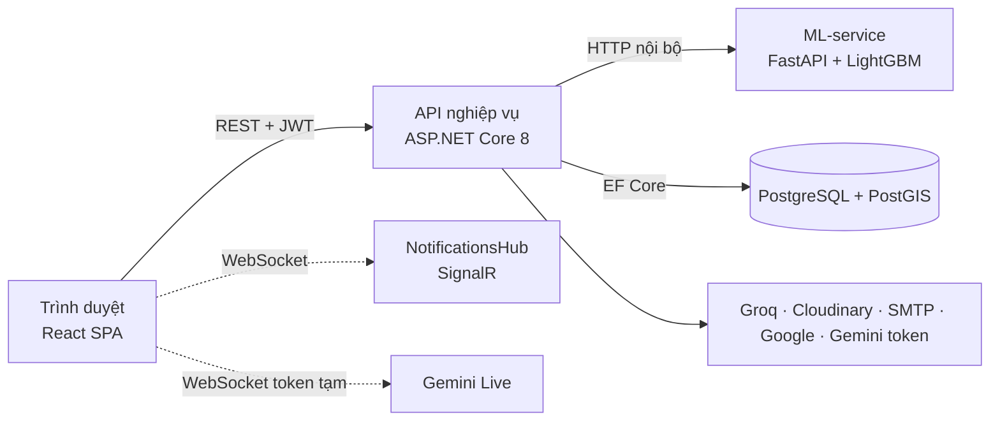
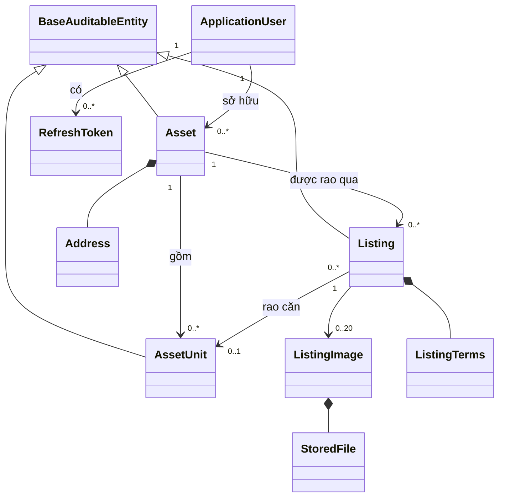
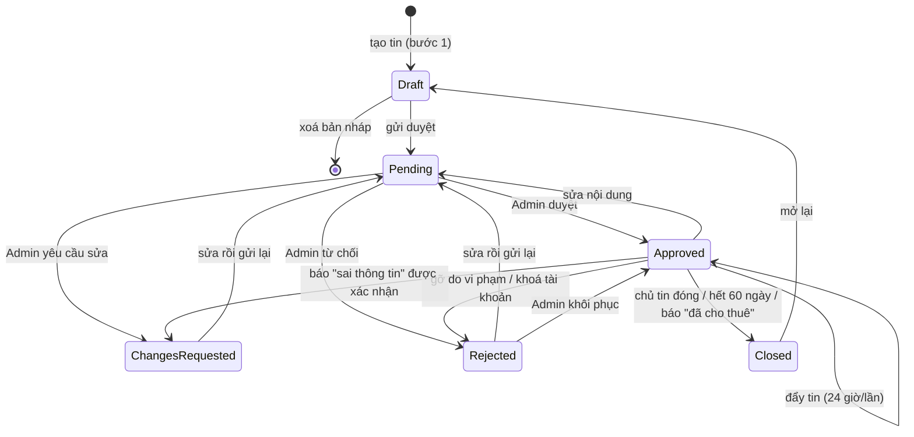
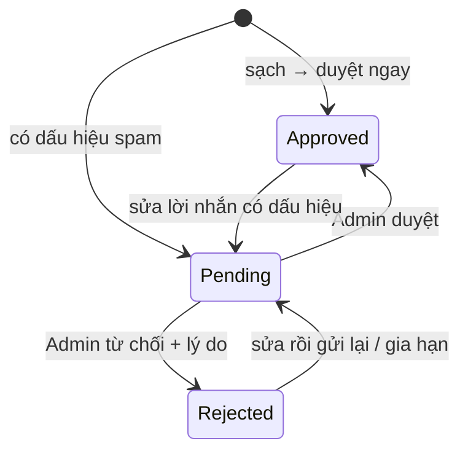
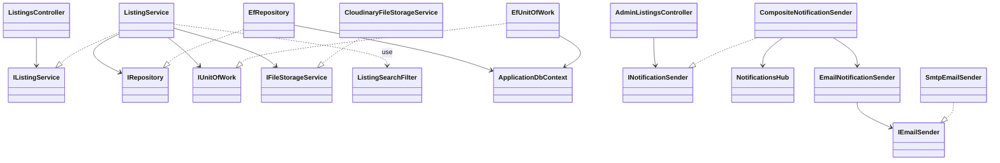

# Thiết kế hệ thống KGS — đọc hiểu bộ sơ đồ

Tài liệu này đi kèm file sơ đồ `SoDo_KGS_VoHoangTuan_v4.drawio` (51 trang) và giải thích **từng hình** theo
cùng thứ tự: hình đó nói gì, đọc nó thế nào, vì sao hệ thống được thiết kế như vậy, và phần tương
ứng nằm ở đâu trong mã nguồn. Mọi con số và tên lớp ở đây đã được đối chiếu với code trên nhánh `main`.
Phần cơ sở dữ liệu có tài liệu riêng, sinh tự động từ mô hình EF Core: [thiet-ke-co-so-du-lieu.md](thiet-ke-co-so-du-lieu.md).

> **Cách dùng:** đọc Phần 0 để có bức tranh tổng thể, rồi [Bộ sơ đồ theo quy trình OOAD](#bộ-sơ-đồ-theo-quy-trình-ooad)
> để biết mỗi hình thuộc bước nào. Sau đó mở từng hình trong draw.io và đọc mục tương ứng. Cuối tài liệu
> có ma trận truy vết, bảng thuật ngữ và bảng "câu hỏi hội đồng hay hỏi".

---

## Mục lục

- [Phần 0. KGS là gì — bức tranh trong một trang](#phần-0-kgs-là-gì--bức-tranh-trong-một-trang)
- [Phần 1. Bối cảnh và quy trình](#phần-1-bối-cảnh-và-quy-trình) — Hình 1.1, 2.2
- [Bộ sơ đồ theo quy trình OOAD](#bộ-sơ-đồ-theo-quy-trình-ooad)
- [Phần 2. Yêu cầu: tác nhân và ca sử dụng](#phần-2-yêu-cầu-tác-nhân-và-ca-sử-dụng) — Hình 2.3, 2.4, 2.4a → 2.4e
- [Phần 3. Mô hình lĩnh vực](#phần-3-mô-hình-lĩnh-vực) — Hình 2.5, 2.6
- [Phần 3b. Lớp phân tích Boundary – Control – Entity](#phần-3b-lớp-phân-tích-boundary--control--entity) — Hình 2.6a, 2.6b
- [Phần 4. Vòng đời các đối tượng](#phần-4-vòng-đời-các-đối-tượng) — Hình 2.7, 2.8
- [Phần 5. Luồng hoạt động và tuần tự](#phần-5-luồng-hoạt-động-và-tuần-tự) — Hình 2.9 → 2.9c, 2.10 → 2.15f
- [Phần 6. Kiến trúc](#phần-6-kiến-trúc) — Hình 2.16, 2.17
- [Phần 7. Thiết kế lớp chi tiết](#phần-7-thiết-kế-lớp-chi-tiết) — Hình 2.18, 2.19, 2.19a → 2.19e
- [Phần 8. Phân tích và thiết kế cơ sở dữ liệu](#phần-8-phân-tích-và-thiết-kế-cơ-sở-dữ-liệu) — Hình 2.20a, 2.20, Bảng 2.y1 → 2.y6
- [Phần 9. Giao diện và điều hướng](#phần-9-giao-diện-và-điều-hướng) — Hình 2.21
- [Phần 10. Triển khai](#phần-10-triển-khai) — Hình 2.23
- [Phụ lục A. Quy tắc nghiệp vụ và con số quan trọng](#phụ-lục-a-quy-tắc-nghiệp-vụ-và-con-số-quan-trọng)
- [Phụ lục B. Thuật ngữ](#phụ-lục-b-thuật-ngữ)
- [Phụ lục C. Câu hỏi hội đồng hay hỏi](#phụ-lục-c-câu-hỏi-hội-đồng-hay-hỏi)
- [Phụ lục D. Ma trận truy vết ca sử dụng](#phụ-lục-d-ma-trận-truy-vết-ca-sử-dụng)

---

## Phần 0. KGS là gì — bức tranh trong một trang

KGS là **sàn giao dịch bất động sản cho thuê và mua bán** tập trung vào sự minh bạch: mỗi tin ghi rõ
tổng chi phí thật (điện, nước, phí dịch vụ, nội quy), toà nhà có thể xem 3D đến từng căn trống, và
người dùng được hỗ trợ bằng AI ở ba chỗ:

| Tính năng AI | Người dùng thấy gì | Công nghệ phía sau |
|---|---|---|
| Trợ lý tìm nhà (gõ) | Gõ "phòng trọ dưới 5 triệu ở Bình Thạnh" → hệ thống tự dựng bộ lọc | LLM Groq trả JSON điều kiện |
| KiGi (giọng nói) | Nói chuyện với linh vật KiGi, nó hỏi lại và đếm số căn khớp | Gemini Live qua WebSocket |
| Định giá | Nhập thông số → giá ước tính kèm khoảng giá và độ tin cậy | Dịch vụ Python LightGBM |

Ngoài tìm–đăng tin, KGS có **ghép đôi hai chiều**: người tìm nhà *đăng nhu cầu* ẩn danh, chủ nhà có
tin phù hợp chủ động *mời* họ xem nhà. Mọi tin đăng và mọi nhu cầu đều qua **kiểm duyệt** (tin luôn
có người duyệt; nhu cầu sạch được duyệt tự động, nhu cầu có dấu hiệu spam chờ quản trị).

**Ba khối chạy độc lập:**



**Bốn vai người dùng:** Khách (chưa đăng nhập), Người tìm nhà, Người đăng tin, Quản trị viên — cộng
một tác nhân hệ thống là **bộ hẹn giờ** (Hangfire) chạy các việc định kỳ.

---

## Phần 1. Bối cảnh và quy trình

### Hình 1.1 — Cơ cấu tổ chức nơi thực tập

Hình cây cho biết đồ án được thực hiện trong **Nhóm kỹ thuật viên** của Công ty TNHH Thương Mại Kỹ
Thuật Không Gian Số, nhánh có nhiệm vụ "khảo sát, thử nghiệm công nghệ mới (AI)". Hình này không mô
tả phần mềm; nó trả lời câu hỏi "đồ án sinh ra trong bối cảnh nào".

### Hình 2.2 — Quy trình phát triển lặp

**Đọc hình:** sáu bước nối thành vòng tròn: Khảo sát → Phân tích, thiết kế → Cài đặt (nhánh tính
năng) → Kiểm thử (xUnit, Vitest) → Tích hợp (Pull Request + CI) → Phản hồi → quay lại Khảo sát.

**Ý nghĩa:** mỗi vòng tạo ra **một phần tăng** dùng được, tương ứng một nhóm Pull Request. Đây là mô
hình *lặp – tăng dần* (iterative-incremental), không phải thác nước.

**Đối chiếu thực tế:**
- Mỗi tính năng có tài liệu thiết kế và kế hoạch trong `docs/superpowers/specs/` và `docs/superpowers/plans/`
  (bước 1–2), được cài trên nhánh riêng như `feat/duyet-nhu-cau` (bước 3).
- Kiểm thử tự động: backend dùng xUnit (`kgs-api/kgs-api.Tests`), frontend dùng Vitest (bước 4).
- `.github/workflows/ci.yml` chạy kiểm thử trên mỗi Pull Request (bước 5).

---

## Bộ sơ đồ theo quy trình OOAD

Bộ sơ đồ đi đúng trình tự phân tích – thiết kế hướng đối tượng; mỗi bước dùng đầu ra của bước trước:

| Bước | Câu hỏi | Hình |
|---|---|---|
| 1. Yêu cầu | Ai dùng hệ thống, làm được gì? | 2.3 (tổng quát, mã UC01–UC24) → 2.4, 2.4a → 2.4e (chi tiết theo từng phân hệ) |
| 2. Mô hình lĩnh vực | Hệ thống nói về những khái niệm nào? | 2.5, 2.6 |
| 3. Phân tích ca sử dụng | Ca sử dụng được thực hiện bởi những đối tượng nào? | 2.6a, 2.6b (Boundary – Control – Entity) |
| 4. Hành vi | Luồng nghiệp vụ, tương tác, vòng đời ra sao? | Hoạt động 2.9 → 2.9c · Tuần tự 2.10 → 2.15f · Trạng thái 2.7, 2.8 |
| 5. Kiến trúc | Chia thành những khối, tầng nào? | 2.16 (thành phần), 2.17 (phân tầng) |
| 6. Thiết kế lớp | Lớp, interface, phụ thuộc cụ thể? | 2.18, 2.19, 2.19a → 2.19e |
| 7. Thiết kế dữ liệu | Lưu trữ thế nào — khái niệm → logic → vật lý? | 2.20a → 2.20 → Bảng 2.y1 → 2.y6 |
| 8. Giao diện, triển khai | Người dùng đi qua những trang nào, chạy ở đâu? | 2.21, 2.23 |
| Truy vết | Mỗi ca sử dụng nằm ở những sơ đồ nào? | Bảng 2.x (Phụ lục D) |

Các hình có hậu tố a/b/c… là hình bổ sung, giữ nguyên số của các hình gốc để không lệch tham chiếu trong báo cáo;
khi chốt báo cáo nên đánh số lại liên tục.

---

## Phần 2. Yêu cầu: tác nhân và ca sử dụng

### Hình 2.3 — Use case tổng quát

**Đọc hình:** khung chữ nhật lớn "Hệ thống KGS" là ranh giới hệ thống; hình người bên ngoài là tác
nhân; mỗi hình elip là một ca sử dụng (việc người dùng làm được). Đường nối tác nhân – elip nghĩa là
"tác nhân này thực hiện ca này".

**Quan hệ tổng quát hoá giữa các tác nhân** (mũi tên tam giác rỗng):

```
Khách  ←  Thành viên  ←  Người tìm nhà
                      ←  Người đăng tin
```

Tác nhân con **thừa hưởng mọi ca** của tác nhân cha. Ví dụ Người tìm nhà làm được mọi việc của Khách
(tìm kiếm, định giá, xem 3D…) cộng thêm việc riêng của mình. Nhờ đó hình không phải vẽ lặp lại.

**Các ca theo tác nhân:**

| Tác nhân | Ca sử dụng | Ghi chú |
|---|---|---|
| Khách | UC01 Tìm kiếm, xem tin · UC02 Tìm bằng trợ lý AI/giọng nói · UC03 Định giá, xem chỉ số giá · UC04 Xem toà nhà 3D · UC05 Đăng ký, đăng nhập | Không cần tài khoản |
| Người tìm nhà | UC06 Lưu tin, lưu bộ lọc · **UC07 Đăng nhu cầu cho chủ nhà mời** · UC08 Gửi yêu cầu xem nhà · UC09 Trả lời lời mời · UC10 Báo vi phạm | "Đăng nhu cầu" khác "lưu bộ lọc": bộ lọc chỉ để nhận báo tin mới; nhu cầu thì chủ nhà nhìn thấy (ẩn danh) và mời được |
| Thành viên | UC11 Quản lý hồ sơ cá nhân · UC12 Xem thông báo | Chung cho mọi người đã đăng nhập |
| Người đăng tin | UC13 Đăng tin · UC14 Quản lý vòng đời tin · UC15 Quản lý toà nhà, dựng 3D · UC16 Xử lý yêu cầu xem nhà · UC17 Ghép đôi: gửi lời mời · UC18 Xem hiệu quả tin | |
| Hệ thống hẹn giờ | UC19 Đóng tin hết hạn, báo tin mới khớp, nhắc nhu cầu | Tác nhân «hệ thống» — không phải con người |
| Quản trị viên | UC20 Kiểm duyệt tin · **UC21 Duyệt nhu cầu** · UC22 Xử lý báo vi phạm · UC23 Quản lý người dùng, tin · UC24 Xem tổng quan | |

Mã UC dùng xuyên suốt mọi sơ đồ sau và trong ma trận truy vết (Phụ lục D); UC13/UC14 trùng với Hình 2.4.

**Vì sao "Hệ thống hẹn giờ" là một tác nhân:** có những việc không ai bấm nút mà vẫn phải xảy ra (tin
quá 60 ngày tự đóng, sáng nào cũng gửi email tin mới khớp bộ lọc). Vẽ nó thành tác nhân giúp thấy rõ
những việc đó khởi phát từ đâu.

### Hình 2.4 — Use case chi tiết "Đăng tin"

**Đọc hình:** hai ca lớn là **UC13 Đăng tin** (bốn bước của biểu mẫu) và **UC14 Vòng đời tin** (các
việc sau khi tin đã tồn tại). Hai tác nhân hệ thống bên ngoài là **ML-service** và **Groq LLM**.

**Hai loại quan hệ đặc biệt:**
- **«include»** — *luôn xảy ra* cùng ca gốc. "Khai loại & vị trí" «include» "Lưu nháp": vừa xong bước
  1 là hệ thống tạo bản nháp ngay, người dùng không cần bấm lưu.
- **«extend»** — *tuỳ chọn*, mũi tên chỉ **về** ca được mở rộng.
  - "Xem gợi ý giá" «extend» "Khai thông số & giá": chỉ hiện với tin bán, do ML-service cung cấp.
  - "AI viết tiêu đề, mô tả" «extend» "Tải ảnh & mô tả": người dùng bấm thì Groq viết từ thông số.

**UC14 Vòng đời tin:** Sửa tin · Đẩy tin (24 giờ một lần) · Đóng tin kèm lý do · Mở lại tin · Xem lịch
sử kiểm duyệt.

**Code:** biểu mẫu `quanly-tai-san/src/routes/dang-tin.tsx`; nghiệp vụ `Services/ListingService.cs`;
AI viết tin `Services/Assistant/ListingWriterService.cs`.

### Hình 2.4a → 2.4e — Use case chi tiết cho từng phân hệ

Mỗi hình là một **phân hệ** (khung lớn), ca chính màu xanh có mã UC, ca con viền trắng nối bằng «include»
(luôn xảy ra) hoặc «extend» (tuỳ chọn, mũi tên chỉ về ca được mở rộng). Hệ thống ngoài vẽ thành tác nhân «hệ thống».

| Hình | Phân hệ | Điểm đáng chú ý |
|---|---|---|
| **2.4a** Tìm kiếm & AI | UC01–UC04 | Lọc theo bản đồ/isochrone, so sánh, tiện ích lân cận «extend» UC01. UC02 «include» "Dịch câu thành bộ lọc" và «include» UC01 — **trợ lý dùng chung truy vấn tìm kiếm**. KiGi «extend» UC02. Tác nhân ngoài: Mapbox, Groq, Gemini, ML-service |
| **2.4b** Nhu cầu & ghép đôi | UC07, UC09, UC17, UC19, UC21 | UC07 «include» "Tự kiểm tra dấu hiệu spam"; "Sửa lời nhắn" và "Gia hạn" «extend» UC07 (sửa lời nhắn cũng kiểm tra lại). "Nhận lời → tạo yêu cầu xem nhà" «extend» UC09. UC17 «include» "Xem nhu cầu khớp (ẩn danh)" |
| **2.4c** Quản trị | UC20–UC24 | UC20 «include» xem chi tiết + ra quyết định có lý do; xử lý hàng loạt «extend». UC22 có 4 kết cục «extend» (gỡ / trả sửa / đóng / bỏ qua). UC23: khoá–mở khoá có lý do, gỡ–khôi phục tin, cấp quyền, ẩn/hiện mô hình 3D |
| **2.4d** Tài khoản | UC05, UC11, UC12 | Đăng ký «include» xác thực email (SMTP); đăng nhập Google, quên mật khẩu và làm mới phiên (xoay vòng token, khi access token hết hạn — khung `opt` ở Hình 2.10) «extend» đăng nhập |
| **2.4e** Tương tác & toà nhà | UC06, UC08, UC10, UC15, UC16, UC18 | Email tin mới «extend» UC06; đề xuất giá/thời gian «extend» UC08; UC15 «include» vẽ mặt bằng + số tầng, công bố/ẩn 3D «extend»; UC16 «include» cập nhật trạng thái (mỗi lần đổi đều báo người hỏi) |

---

## Phần 3. Mô hình lĩnh vực

Hai hình 2.5–2.6 là **sơ đồ lớp lĩnh vực** (domain model): các khái niệm nghiệp vụ và quan hệ giữa
chúng, chưa quan tâm đến controller hay service.

**Đọc ký pháp:**
- Khung chia ba phần: tên lớp / thuộc tính / phương thức. `+` là công khai, `?` là cho phép rỗng.
- Đường nối có số ở hai đầu là **bội số**: `1` — đúng một; `0..*` — không hoặc nhiều; `0..1` —
  không hoặc một; `0..20` — tối đa 20.
- Mũi tên tam giác rỗng: kế thừa. «value object»: đối tượng giá trị, không có định danh riêng, sống
  bên trong đối tượng chủ.

### Hình 2.5 — Lớp lĩnh vực 1: người dùng, tài sản, tin đăng



**Ý tưởng cốt lõi — tách "tài sản" khỏi "tin đăng":**
- **Asset** là bất động sản thật (một căn nhà, một toà nhà) với địa chỉ, diện tích, số tầng, vị trí
  bản đồ, mô hình 3D.
- **Listing** là *một lần rao* tài sản đó, có giá, trạng thái, nội dung. Một tài sản có thể được rao
  nhiều lần theo thời gian (đóng tin rồi đăng lại).
- **AssetUnit** là một căn/phòng trong toà nhà. Tin có thể rao **cả tài sản** hoặc **một căn** (`0..1`).

**Các lớp hỗ trợ:**
- **BaseAuditableEntity** — lớp cha trừu tượng cung cấp `Id`, `CreatedAt`, `UpdatedAt`, `CreatedBy`,
  `UpdatedBy` để mọi bản ghi tự có dấu vết "ai tạo, ai sửa, khi nào".
- **ApplicationUser** — người dùng (kế thừa `IdentityUser` của ASP.NET Identity), thêm `Name`,
  `AvatarUrl`, `Bio`, và `AdminLockReason`/`AdminLockedAt` để quản trị khoá tài khoản kèm lý do.
- **RefreshToken** — phiên đăng nhập dài hạn; `RevokedAt` và `ReplacedByToken` phục vụ cơ chế xoay vòng
  token (xem Hình 2.10).
- **Address** (value object) — lưu **cả địa chỉ cũ** (Tỉnh/Quận/Phường) **lẫn mã mới** sau sắp xếp đơn
  vị hành chính 2025 (`NewProvinceCode`, `NewWardCode`), để tìm được bằng cả hai cách gọi.
- **ListingTerms** (value object) — điều khoản thuê: số tháng cọc, giá điện, giá nước, phí dịch vụ, nuôi
  thú cưng, giờ giấc tự do. Đây chính là phần "tổng chi phí thật".
- **ListingImage / StoredFile** — ảnh tin (tối đa 20), lưu trên Cloudinary bằng `Url` + `PublicId`
  (PublicId dùng để xoá ảnh khi cần).

**Code:** `kgs-api/kgs-api/Domain/Entity/`, `Domain/ValueObjects/`, `Common/BaseAuditableEntity.cs`.

### Hình 2.6 — Lớp lĩnh vực 2: tương tác quanh tin đăng

Hình xoay quanh **ApplicationUser** (trên) và **Listing** (dưới); mọi lớp ở giữa là một kiểu tương
tác giữa người dùng và tin.

| Lớp | Ý nghĩa | Quan hệ đáng chú ý |
|---|---|---|
| **Notification** | Thông báo trong chuông và email | Người dùng `1 → 0..*` |
| **SavedSearch** | Bộ lọc đã lưu — và khi bật "mở cho chủ nhà" thì trở thành **nhu cầu** | Người dùng `1 → 0..20` (tối đa 20) |
| **SavedListing** | Tin đã lưu | Khoá ghép (UserId, ListingId) |
| **ListingReport** | Báo vi phạm | Có trạng thái xử lý và ghi chú của quản trị |
| **ListingInquiry** | Yêu cầu xem nhà | Người gửi và người nhận đều là User |
| **ListingInvitation** | Lời mời ghép đôi: chủ nhà mời một nhu cầu | Gắn với tin (`1`), với nhu cầu (`0..1`), và **tạo ra** một Inquiry khi người tìm nhận lời (`0..1`) |
| **ListingView** | Một lượt xem đã khử trùng | Lưu `ViewerHash` (băm IP + trình duyệt), không lưu IP thô |
| **ListingModerationEvent** | Một sự kiện trong lịch sử kiểm duyệt | `Action`, danh sách lý do, `Round` (vòng duyệt thứ mấy) |
| **DemandOpening** | Một lần người tìm **mở** nhu cầu (đăng mới hoặc bật lại) | Dùng để đếm "đăng dày" — vẫn đếm được kể cả khi nhu cầu đã bị xoá |

**SavedSearch — hai vai trong một lớp:**
- `NotifyEnabled` bật → sáng nào cũng nhận email tin mới khớp.
- `DiscoverableByOwners` bật → trở thành **nhu cầu**: chủ nhà có tin phù hợp thấy được (ẩn danh), đọc
  được `DemandNote` (lời nhắn), và mời được. Nhu cầu có hạn 30 ngày (`DiscoverableUntil`).
- `DemandReview` / `DemandReviewReason` — kết quả kiểm duyệt nhu cầu (Approved / Pending / Rejected)
  và lý do (xem Hình 2.8).

**Kế thừa (ghi chú dưới hình):** Notification, SavedSearch, ListingReport, ListingInquiry,
ListingInvitation, ListingModerationEvent kế thừa BaseAuditableEntity. SavedListing, ListingView,
DemandOpening là **bảng ghi nhận** gọn nhẹ nên không kế thừa.

---

## Phần 3b. Lớp phân tích Boundary – Control – Entity

Đây là bước nối **phân tích** với **thiết kế**: với mỗi ca sử dụng quan trọng, chia trách nhiệm cho ba loại
lớp phân tích (còn gọi là sơ đồ robustness), trước khi nghĩ tới controller hay service cụ thể.

| Ký hiệu | Loại | Trách nhiệm | Ví dụ |
|---|---|---|---|
| ⊢○ | **Boundary** (lớp biên) | Giao tiếp với tác nhân hoặc hệ thống ngoài | Trang Đăng tin, Cổng ML-service |
| ○ có mũi tên | **Control** (lớp điều khiển) | Điều phối một ca sử dụng, chứa quy tắc | ĐK đăng tin (nháp, gửi duyệt, BR-01) |
| ○ gạch dưới | **Entity** (lớp thực thể) | Dữ liệu sống lâu, lưu trong CSDL | Listing, SavedSearch |

**Quy tắc giao tiếp:** tác nhân chỉ nói với lớp biên; lớp biên chỉ gọi lớp điều khiển; chỉ lớp điều khiển
chạm tới lớp thực thể; lớp điều khiển có thể gọi lớp điều khiển khác. Quy tắc này chính là lý do kiến trúc
có tầng Controller → Service → Repository (Hình 2.17).

### Hình 2.6a — Đăng tin & kiểm duyệt (UC13, UC14, UC20)

- **Biên:** Trang Đăng tin 4 bước, Trang Tin của tôi, Trang Duyệt tin; Cổng ML-service, Cổng Groq LLM.
- **Điều khiển:** ĐK gợi ý giá, ĐK viết tin bằng AI, ĐK đăng tin, ĐK kiểm duyệt, ĐK thông báo.
- **Thực thể:** Asset, Listing, ListingImage, ListingModerationEvent, Notification.
- **Ánh xạ sang thiết kế:** Trang → route React (`dang-tin.tsx`, `tin-cua-toi.tsx`, `admin.listings.tsx`) ·
  ĐK đăng tin → `ListingService` · ĐK kiểm duyệt → `AdminListingsController` · ĐK thông báo →
  `CompositeNotificationSender` · ĐK gợi ý giá → `ValuationService` · ĐK viết tin → `ListingWriterService`.

### Hình 2.6b — Nhu cầu & ghép đôi (UC07, UC09, UC17, UC21)

- **Biên:** Trang Nhu cầu & lời mời, Ô ghép đôi ở Tin của tôi, Trang Duyệt nhu cầu.
- **Điều khiển:** ĐK nhu cầu, ĐK sàng lọc spam, ĐK ghép đôi, ĐK duyệt nhu cầu, ĐK thông báo.
- **Thực thể:** SavedSearch, DemandOpening, Listing, ListingInvitation, ListingInquiry, Notification.
- **Ánh xạ sang thiết kế (Hình 2.19a):** ĐK nhu cầu → `SavedSearchService` · ĐK sàng lọc spam →
  `DemandScreening` «static» · ĐK ghép đôi → `MatchmakingService` · ĐK duyệt nhu cầu → `AdminDemandService`.

---

## Phần 4. Vòng đời các đối tượng

**Đọc ký pháp sơ đồ trạng thái:** chấm đen đặc là điểm bắt đầu; chấm có viền là điểm kết thúc; hộp bo
góc là trạng thái; mũi tên là chuyển trạng thái, nhãn trên mũi tên là sự kiện gây ra nó.

### Hình 2.7 — Trạng thái tin đăng



**Những quyết định thiết kế nên nhớ:**
1. **Sửa tin đã duyệt → quay về Pending.** Nếu không, người đăng có thể qua duyệt bằng nội dung sạch
   rồi thay bằng nội dung khác.
2. **Mở lại tin đã đóng → về Draft, không lên thẳng Approved.** Giá, ngày trống có thể đã cũ; tin mở lại
   phải duyệt như tin mới.
3. **Hai kiểu trả về:** *ChangesRequested* (sửa nhỏ rồi gửi lại) khác *Rejected* (vi phạm). Lý do được
   chọn từ danh sách có cấu trúc để thống kê được người đăng hay sai ở đâu.
4. **Khôi phục thông minh:** nếu tin bị gỡ khi *còn đang chờ duyệt* thì khôi phục sẽ đưa về **Pending**,
   không cho lên sóng khi chưa ai duyệt.
5. **Báo vi phạm tác động trực tiếp:** "sai thông tin" → ChangesRequested; "đã cho thuê/bán" → Closed;
   vi phạm nặng → Rejected (bị gỡ).
6. Mỗi chuyển trạng thái do kiểm duyệt đều ghi một `ListingModerationEvent` → có lịch sử đầy đủ.

**Code:** enum `ListingStatus` trong `Domain/Enums.cs`; `ListingService.cs` (gửi, sửa, đóng, mở lại,
đẩy tin); `Services/Admin/AdminManagementService.cs` (gỡ, khôi phục); `Domain/Rules/ReportOutcomes.cs`
(báo vi phạm → trạng thái); `ListingExpiryJob.cs` (đóng sau 60 ngày).

### Hình 2.8 — Trạng thái các đối tượng khác

Hình có **bốn máy trạng thái** độc lập.

**1. Yêu cầu xem nhà (ListingInquiry):** `New → Contacted → Viewed → Closed`, và có thể huỷ (Closed)
từ New hoặc Contacted. Chủ nhà là người đổi trạng thái; mỗi lần đổi có ý nghĩa thì người hỏi nhận
thông báo ("chủ nhà đã ghi nhận", "đã dẫn đi xem", "đã đóng"). Hình vẽ luồng *điển hình*; code cho phép
chủ nhà chọn trạng thái bất kỳ.

**2. Lời mời (ListingInvitation):** `Pending → Accepted | Declined | Expired`.
- **Expired là trạng thái *suy ra*, không lưu trong CSDL**: lời mời Pending quá 14 ngày được *coi là*
  hết hạn khi đọc. Nhờ vậy không cần một tác vụ định kỳ chỉ để đổi một cột.
- Nhận lời → tạo một ListingInquiry, lúc đó người tìm mới lộ tên và số điện thoại.

**3. Báo vi phạm (ListingReport):** `Pending → Resolved` (xác nhận vi phạm và đã xử lý tin) hoặc
`Pending → Dismissed` (kết luận không vi phạm).

**4. Duyệt nhu cầu (SavedSearch.DemandReview):**



- **Dấu hiệu spam** do quy tắc `DemandScreening` phát hiện (Phụ lục A): lời nhắn có đường liên kết, số
  điện thoại, email, kênh liên lạc riêng (Zalo, Facebook…), giống tin rao vặt; tài khoản chưa xác thực
  email; hoặc mở quá 3 nhu cầu trong 24 giờ.
- **Chỉ nhu cầu Approved** mới hiện cho chủ nhà và được tính vào số liệu Nhịp cầu.
- **Gửi lại sau khi bị từ chối luôn phải chờ duyệt lại**, kể cả khi lần này sạch — nếu không, người
  spam chỉ cần đợi qua 24 giờ là tự được duyệt với đúng nội dung đã bị từ chối.

**Code:** `Domain/Enums.cs`; `MarketplaceEngagementService.cs` (yêu cầu xem nhà);
`MatchmakingService.cs` (lời mời, 14 ngày); `ListingReportService.cs`; `Domain/Rules/DemandScreening.cs`,
`SavedSearchService.cs`, `Services/Admin/AdminDemandService.cs` (duyệt nhu cầu).

---

## Phần 5. Luồng hoạt động và tuần tự

### Hình 2.9 — Sơ đồ hoạt động "Đăng tin"

**Đọc hình:** ba làn bơi (swimlane) — **Người đăng tin**, **Hệ thống**, **Quản trị viên** — cho biết ai
làm bước nào. Hình thoi là điểm rẽ nhánh.

**Luồng chính:**
1. Bước 1: chọn loại, địa chỉ, ghim vị trí, khai *chính chủ / môi giới* → hệ thống **tạo bản nháp**.
2. Bước 2: thông số, giá. *Nếu là tin bán* → hệ thống gọi ML-service lấy **gợi ý giá**.
3. Bước 3: ảnh, tiêu đề, mô tả. *Nếu chọn AI viết* → Groq viết từ thông số → người đăng chỉnh lại.
4. Bước 4: chi phí, cọc, nội quy, xem trước → **Gửi duyệt**.
5. Hệ thống kiểm tra **BR-01: đã có tin đang sống cho cùng bất động sản/căn chưa?**
   - Có → báo lỗi, giữ bản nháp.
   - Không → tin chuyển **Pending**, hàng đợi của quản trị **tự cập nhật** (SignalR).
6. Quản trị xem xét: **Duyệt** → tin công khai, báo người đăng; **Yêu cầu sửa / Từ chối** → người đăng
   sửa theo lý do và gửi lại.

**Vì sao kiểm BR-01 lúc gửi chứ không lúc tạo:** bản nháp không hiện ra ngoài, nên cho phép nhiều bản
nháp; chỉ khi muốn *lên sóng* mới cần bảo đảm "một chỗ chỉ có một tin đang sống" để không có tin trùng.

### Hình 2.9a — Hoạt động "Đăng nhu cầu và kiểm duyệt" (UC07, UC21)

Ba làn bơi: Người tìm nhà · Hệ thống · Quản trị viên.
1. Người tìm chọn điều kiện, bật "Mở cho chủ nhà mời", viết lời nhắn, gửi.
2. Hệ thống kiểm **đã chọn tỉnh/thành chưa** (chưa → quay lại).
3. Đếm số lần mở nhu cầu trong 24 giờ (bảng `DemandOpenings`), chạy quy tắc `DemandScreening`.
4. **Có dấu hiệu hoặc từng bị từ chối?** — Không → **Approved**, hiện cho chủ nhà ngay, hạn 30 ngày.
   Có → **Pending**, lưu lý do, báo "đang chờ duyệt".
5. Quản trị xem nhu cầu kèm dấu hiệu → **Duyệt** (Approved, tính lại hạn 30 ngày từ lúc duyệt, thông báo) hoặc
   **Từ chối** (Rejected + lý do, thông báo).
6. Bị từ chối → người tìm sửa lời nhắn, gửi lại → quay về bước 3 và **luôn chờ duyệt lại**.

### Hình 2.9b — Hoạt động "Xử lý báo vi phạm" (UC10, UC22)

1. Người tìm bấm "Báo vi phạm", chọn lý do, ghi chi tiết.
2. Hệ thống chặn **tự báo tin của mình** và **bỏ qua báo trùng** (đã có báo cáo Pending của cùng người cho cùng tin).
3. Lưu `ListingReport (Pending)` → quản trị xem cùng tin đăng.
4. Bốn kết cục: **lừa đảo/rác → gỡ tin** (Rejected, ghi TakenDown) · **sai thông tin → trả về sửa**
   (ChangesRequested) · **đã cho thuê → đóng tin** (Closed) · **không vi phạm → Dismissed**.
5. Ba kết cục đầu hội về "Report = Resolved, thông báo chủ tin kèm lý do".

### Hình 2.9c — Hoạt động "Tác vụ định kỳ" (UC19)

Một làn: Hệ thống hẹn giờ (Hangfire).
- **08:00 — ListingExpiryJob:** tin Approved hiển thị quá 60 ngày → đóng (Expired), ghi lý do vào ghi chú kiểm
  duyệt để chủ tin thấy ở "Tin của tôi" và có thể mở lại (job này không gửi thông báo).
- **08:30 — SavedSearchAlertJob:** xử lý hạn nhu cầu (còn 3 ngày → nhắc gia hạn, *chỉ nhu cầu đã duyệt*;
  hết hạn → tắt chế độ mở), rồi **lặp qua từng bộ lọc bật báo tin**: tìm tin mới sau `LastCheckedAt` bằng
  `BuildMatchQuery` → có thì gửi email tóm tắt → cập nhật `LastCheckedAt`.
- **Chạy độc lập:** FileCleanupJob (30 phút/lần, xoá ảnh trong `FileDeletionQueueItems`, thử lại khi lỗi),
  RefreshTokenCleanupJob (hằng ngày). Ngoài lịch: **DemandMatchNotifyJob** được đưa vào hàng đợi mỗi khi
  quản trị duyệt một tin, báo chủ tin số nhu cầu đang khớp.

### Cách đọc các sơ đồ tuần tự (Hình 2.10 → 2.15f)

- Mỗi cột là một **đối tượng tham gia**, đường đứt dọc là đường đời của nó.
- Mũi tên liền có số thứ tự là **lời gọi**; mũi tên đứt là **kết quả trả về**.
- Khung `alt` = rẽ nhánh (chỉ một nhánh xảy ra); `opt` = tuỳ chọn (có thể không xảy ra); `loop` = lặp.

### Hình 2.10 — Đăng nhập và làm mới phiên

Tham gia: Người dùng → Web SPA → `AccountController` → `AuthService` → `TokenService` → PostgreSQL.

1–4. Người dùng nhập email, mật khẩu → `POST /api/account/login` → `AuthService.LoginAsync` tìm user,
     kiểm mật khẩu và **trạng thái khoá**.
- **alt [sai mật khẩu / bị khoá]:** trả 401/403 **kèm lý do** (ví dụ lý do quản trị khoá tài khoản).
- **alt [hợp lệ]:** tạo **access token JWT sống 60 phút** và **refresh token sống 7 ngày**, lưu
  RefreshToken vào CSDL, trả cặp token. SPA gắn JWT vào header mọi request và chuyển vào trang theo vai trò.

**opt [access token hết hạn]:** SPA gọi `POST /api/account/refresh` → `RotateAsync`: **thu hồi token cũ**
(ghi `RevokedAt`, `ReplacedByToken`) và cấp cặp mới.

**Vì sao hai loại token:** JWT ngắn hạn để nếu bị lộ thì chỉ dùng được ít phút; refresh token dài hạn
nằm trong CSDL nên **thu hồi được**. Xoay vòng (mỗi lần làm mới cấp token mới, huỷ token cũ) giúp
phát hiện token bị đánh cắp: token cũ dùng lại sẽ không hợp lệ.

### Hình 2.11 — Trợ lý AI tìm nhà (gõ)

Tham gia: Khách → Web SPA → `AssistantController` → `SearchAssistantService` → `GroqChatClient` → Groq
LLM; sau đó `ListingsController`.

1–3. Khách gõ câu tự nhiên → `POST /api/assistant/search-intent` (kèm kết quả lần trước để hiểu câu
     nối tiếp như "rẻ hơn chút") → `ParseAsync`.
4–8. Gọi Groq với prompt, danh sách khu vực hợp lệ và **lược đồ JSON** bắt buộc. Mô hình chính
     `gpt-oss-120b`; lỗi thì thử **mô hình dự phòng** (qwen3, gpt-oss-20b).
9. **`Validate()`** — bước quan trọng nhất: kiểm từng trường, chuẩn hoá giá ("2tr5" → 2.500.000), **bỏ
   điều kiện không hiểu được** thay vì đoán bừa.
10–11. Trả `criteria` (bộ lọc), `preferences` (ưu tiên mềm), `anchor` (điểm mốc như "gần trường"),
       `unrecognized` (phần không hiểu — hiện cho người dùng biết).
12–14. SPA gọi `GET /api/listings/search` **với đúng bộ lọc của trang Tìm nhà** → hiện thẻ điều kiện +
       kết quả.

**opt [hết hạn mức / quá 20 giây]:** báo người dùng chuyển sang dùng bộ lọc thường.

**Vì sao LLM chỉ dịch câu thành bộ lọc, không trả về tin:** kết quả luôn đến từ CSDL thật qua cùng một
truy vấn tìm kiếm → AI không thể "bịa" ra căn nhà không tồn tại.

### Hình 2.12 — Kiểm duyệt tin (thời gian thực)

Tham gia: người đăng và web của họ, `ListingsController/ListingService`, PostgreSQL,
**NotificationsHub (SignalR)**, `AdminListingsController`, web quản trị, quản trị viên.

1–6. Người đăng bấm gửi → `POST /api/listings/{id}/submit` → kiểm BR-01, `Status = Pending`, ghi
     `ModerationEvent(Submitted)` → **báo nhóm admin qua SignalR** → người đăng thấy "Chờ duyệt".
7. Web quản trị nhận sự kiện → **hàng đợi tự làm mới**, không cần F5.
8–12. Quản trị chọn "Yêu cầu sửa" + lý do → `POST /api/admin/listings/{id}/request-changes` →
      `Status = ChangesRequested`, ghi sự kiện, tạo Notification → đẩy thông báo tới người đăng và báo
      các admin khác.
13–14. Hàng đợi của mọi admin cập nhật; người đăng thấy chuông thông báo và trạng thái tin đổi ngay.

**Vì sao cần SignalR:** khi nhiều quản trị cùng làm, ai cũng thấy hàng đợi mới nhất → không hai người
cùng duyệt một tin; người đăng biết kết quả ngay thay vì phải tải lại trang.

### Hình 2.13 — Định giá

Tham gia: Khách → Web SPA → `ValuationController/ValuationService` → ML-service (FastAPI).

- **alt [mạch đang ngắt — có lỗi trong 30 giây qua]:** trả ngay "Chưa có giá tham khảo", **không gọi
  ML-service**.
- **alt [bình thường]:** `POST /valuation`, chờ **tối đa 5 giây**. ML-service chuẩn hoá địa danh → tạo
  đặc trưng → mô hình **LightGBM** → **khoảng conformal** (khoảng giá có bảo đảm thống kê) → độ tin cậy.
  Trả `price`, `priceLow`, `priceHigh`, `confidence`, `areaMedian`, `notes`. Giao diện hiện giá ước tính,
  khoảng giá, độ tin cậy, và so với giá người dùng nhập.

**Vì sao có "cầu dao" (circuit breaker):** ô gợi ý giá nằm cạnh biểu mẫu đăng tin. Nếu ML-service chết,
không thể để mỗi lần gõ phải chờ 5 giây. Gặp lỗi kết nối thì "ngắt mạch" 30 giây, sau đó thử lại một lần.
Định giá hỏng thì **sàn vẫn chạy bình thường**, chỉ ẩn ô gợi ý.

**Phạm vi:** mô hình học từ dữ liệu **tin bán** (nguồn dữ liệu công khai không có tin thuê), nên chỉ
định giá mảng mua bán.

### Hình 2.14 — KiGi, trợ lý giọng nói

Tham gia: Khách → Trình duyệt (`useGeminiLive`) → `VoiceController` → Gemini Live; sau đó
`AssistantController` và `ListingsController`.

1–5. Bấm micro → `POST /api/voice/session` → API dùng khoá thật xin Google một **token tạm**: dùng 1 lần,
     sống 4 phút, **khoá cứng mô hình + lời dặn + danh sách công cụ** → trả token cho trình duyệt.
6–7. Trình duyệt mở **WebSocket trực tiếp tới Gemini** bằng token tạm, gửi âm thanh **PCM 16 kHz**;
     KiGi chào bằng âm thanh **24 kHz**.
8. Người dùng nói nhu cầu; **im 1,2 giây** được coi là hết lượt.
9–13. Gemini gọi công cụ `cap_nhat_nhu_cau(mô tả)` → trình duyệt chạy **cùng pipeline với trợ lý gõ**
      (Hình 2.11) để ra điều kiện, rồi đếm số căn (nếu 0 căn thì gợi ý nới điều kiện).
14–15. Kết quả công cụ (điều kiện, số căn, còn thiếu gì) gửi lại Gemini → KiGi đọc số căn, hỏi bù.
16–17. Bấm "Xem N căn" → sang trang Tìm nhà với bộ lọc đã dựng.

**Vì sao thiết kế như vậy:**
- **Khoá API không bao giờ xuống trình duyệt** — chỉ token tạm, lộ cũng gần như vô dụng.
- **Âm thanh đi thẳng trình duyệt ↔ Google**, không qua máy chủ KGS → độ trễ thấp, máy chủ nhẹ.
- **Tái dùng pipeline trợ lý gõ** → nói hay gõ đều ra cùng bộ lọc, chỉ phải bảo trì một chỗ.
- Giới hạn 5 phiên / 10 phút để bảo vệ hạn mức Gemini miễn phí.

### Hình 2.15 — Ghép đôi chủ nhà ↔ người tìm nhà

Tham gia: Người đăng tin → `MatchmakingController/MatchmakingService` → `SavedSearchService` →
PostgreSQL → Người tìm nhà.

1–5. Chủ nhà mở tin của mình → `GET /matchmaking/listings/{id}/demands` → lấy **tối đa 300 nhu cầu đang
     mở (đã duyệt, chưa hết hạn)** → **loop [mỗi nhu cầu]:** dùng `BuildMatchQuery()` hỏi "tin này có
     lọt qua bộ lọc của nhu cầu không?" → trả danh sách nhu cầu **ẩn danh** kèm lý do khớp.
6–9. Chủ nhà gửi lời mời → `POST /matchmaking/listings/{id}/invitations` → tạo
     `ListingInvitation(Pending)` + Notification → người tìm nhận thông báo (SignalR + email) → 201 Created.
10–13. Người tìm nhận lời → `POST /matchmaking/invitations/{id}/respond` → Invitation = Accepted, **tạo
       ListingInquiry** và gắn `InquiryId` → chủ nhà nhận thông báo "có yêu cầu xem nhà", **lúc này mới
       lộ tên, số điện thoại**.

**Vì sao khớp bằng "chính truy vấn tìm kiếm":** nhu cầu là một bộ lọc tìm kiếm đã lưu. Dùng lại đúng
truy vấn đó thì "khớp" có nghĩa y như khi người tìm tự bấm Tìm — không có hai định nghĩa khớp khác nhau.

**Bảo vệ người tìm nhà:** danh tính ẩn tới khi họ nhận lời; mỗi chủ nhà gửi tối đa 30 lời mời/ngày; lời
mời hết hạn sau 14 ngày; trần 300 nhu cầu mỗi lần quét để truy vấn luôn nhanh.

### Hình 2.15a — Đăng nhu cầu và duyệt nhu cầu (UC07, UC21)

Tham gia: Người tìm nhà → Web SPA → `SavedSearchesController/SavedSearchService` → `DemandScreening` «static»
→ PostgreSQL → `AdminDemandsController/AdminDemandService` → Quản trị viên.

1–9. `POST /api/saved-searches {discoverable, demandNote}` → đếm số lần mở trong 24 giờ → `Screen(...)` trả danh
sách dấu hiệu → `Decide(dấu hiệu, trạng thái cũ)` trả `(Approved | Pending, lý do)` → lưu `SavedSearch` + `DemandOpening`.
**alt** [không có dấu hiệu] 201 + Approved · [có dấu hiệu hoặc gửi lại sau khi bị từ chối] 201 + Pending + lý do.
13–19. Quản trị `GET /api/admin/demands/pending` (đã bỏ toạ độ ghim — quyền riêng tư) → `POST /{id}/reject`
→ kiểm **còn Pending không** (không → 409, tránh xử lý trùng) → lưu Rejected + lý do → thông báo người tìm → 204.

### Hình 2.15b — Đăng tin và tải ảnh (UC13, UC14)

1–4. Bước 1 → `POST /api/listings` → tạo `Asset` (nếu mới, kèm toạ độ PostGIS) + `Listing (Draft)` → 201.
5–6. Bước 2–4 → `PUT /api/listings/{id}`; nếu tin đang Approved thì tự quay về Pending.
**loop [mỗi ảnh]:** `POST /{id}/images` → đếm ảnh hiện có (tối đa 20) → `CloudinaryFileStorageService.UploadAsync`
→ Cloudinary trả `url, publicId` → lưu `ListingImage`. 16. Gửi duyệt → tiếp ở Hình 2.12.

### Hình 2.15c — Yêu cầu xem nhà (UC08, UC16)

1–7. `POST /api/listings/{slug}/inquiries` → **alt [hợp lệ]:** tin còn Approved, không phải tin của mình, chưa có
yêu cầu đang mở → lưu `ListingInquiry (New)` → `INotificationSender` báo chủ tin (chuông + email) → 201.
8–12. Chủ tin `PUT /api/inquiries/{id}/status` (Contacted / Viewed / Closed) → cập nhật → báo người hỏi câu
tương ứng ("đã ghi nhận", "đã dẫn đi xem", "đã đóng").

### Hình 2.15d — Xử lý báo vi phạm (UC10, UC22)

1–4. `POST /api/listings/{slug}/reports` → kiểm không tự báo, không trùng → lưu `ListingReport (Pending)` → 204.
5–14. Quản trị `POST /api/admin/listing-reports/{id}/resolve {TakeDown | RequestChanges | MarkTaken}` →
`ListingReportService.ResolveAsync` → **`ReportOutcomes.Apply`** (lớp tĩnh, hàm thuần; nếu quản trị không chọn
hướng xử lý thì dùng `DefaultAction(lý do báo)`) trả trạng thái tin + hành
động kiểm duyệt → cập nhật `Listing.Status`, ghi `ListingModerationEvent`, Report = Resolved → báo chủ tin.

### Hình 2.15e — Báo tin mới định kỳ (UC06, UC19)

Hangfire gọi `SavedSearchAlertJob.RunAsync()` lúc 08:30 → `ProcessDemandExpiryAsync` → lấy các bộ lọc bật báo tin →
**loop [mỗi bộ lọc]:** `SavedSearchService.BuildMatchQuery` → đếm + lấy vài tin sau `LastCheckedAt` →
**opt [có tin mới]:** `INotificationSender.SendAsync` (email + chuông) → cập nhật `LastCheckedAt`.
Lỗi ở một bộ lọc chỉ bỏ qua bộ lọc đó, không dừng cả lượt.

### Hình 2.15f — Dựng mô hình 3D (UC15, UC04)

1–5. Chủ tin vẽ mặt bằng trên bản đồ, khai số tầng, chiều cao tầng → `PUT /api/assets/{id}/building-model` →
`ValidateFootprint()` (đa giác hợp lệ, đúng chủ) → lưu `FootprintJson` (làm tròn 7 chữ số), `Floors`, `Published`.
6–10. Khách mở chi tiết tin → `GET /api/listings/{slug}/building` → chỉ trả mô hình **đã công bố** (quản trị có thể
ẩn) → Mapbox GL dựng khối 3D bằng `fill-extrusion`, tô màu căn trống.

---

## Phần 6. Kiến trúc

### Hình 2.16 — Sơ đồ thành phần

Ba vùng: **Trình duyệt**, **Máy chủ ứng dụng**, **Dịch vụ bên ngoài**. Nét liền là gọi đồng bộ, nét
đứt là kết nối thời gian thực (WebSocket).

| Thành phần | Công nghệ | Vai trò |
|---|---|---|
| Web SPA | React 19, TanStack Router/Query | 30 trang, chia 3 không gian theo vai trò |
| useGeminiLive | Web Audio API | Thu micro, phát âm thanh, nói chuyện với Gemini |
| Mapbox GL / Leaflet | | Bản đồ, vùng đi được trong X phút (isochrone), dựng 3D toà nhà |
| API nghiệp vụ | ASP.NET Core 8 | 24 controller, 118 điểm cuối — trung tâm của hệ thống |
| ML-service | Python, FastAPI, LightGBM | Định giá và chỉ số giá |
| PostgreSQL + PostGIS | | Dữ liệu nghiệp vụ; PostGIS cho truy vấn không gian (bán kính, khung nhìn bản đồ) |
| NotificationsHub | SignalR | Đẩy thông báo và cập nhật hàng đợi theo thời gian thực |
| Hangfire | | 4 tác vụ định kỳ (xem dưới) |
| Dịch vụ ngoài | Groq, Cloudinary, SMTP (MailKit), Google Sign-In, Gemini Live, Mapbox | LLM, lưu ảnh, gửi email, đăng nhập Google, giọng nói, bản đồ |

**Bốn tác vụ Hangfire:**

| Tác vụ | Lịch | Việc làm |
|---|---|---|
| `refresh-token-cleanup` | Hằng ngày | Dọn refresh token hết hạn |
| `file-cleanup` | 30 phút/lần | Xoá ảnh trên Cloudinary của tin/ảnh đã xoá |
| `listing-expiry` | 08:00 giờ VN | Đóng tin quá 60 ngày hiển thị |
| `saved-search-alerts` | 08:30 giờ VN | Email tin mới khớp bộ lọc; nhắc và đóng nhu cầu hết hạn |

**Vì sao ML-service là dịch vụ riêng:** hệ sinh thái máy học sống ở Python; mô hình huấn luyện lại theo
nhịp khác với tính năng; và **hỏng độc lập** — ML-service chết thì sàn vẫn chạy.

### Hình 2.17 — Phân tầng API

```
Tầng trình diễn        Controllers, Hubs, DTO, kiểm tra đầu vào
        │ gọi
Tầng nghiệp vụ         Services, Interfaces (IListingService, IValuationService…)
        │ dùng                     │ qua interface
Tầng miền              Entity, Value Object, quy tắc nghiệp vụ (Domain/Rules)
        ▲ ánh xạ                   │
Tầng truy cập dữ liệu  ApplicationDbContext, Repository, Unit of Work
        │ SQL
PostgreSQL + PostGIS

Hạ tầng xuyên suốt (bên cạnh, tiêm vào mọi tầng): DI container · JWT, phân quyền ·
Rate limiting · Middleware lỗi · Options cấu hình · Logging
```

**Quy tắc:** mũi tên chỉ chiều phụ thuộc — tầng trên chỉ gọi tầng dưới, không gọi ngược.

**Điểm hay của cách tổ chức này:**
- **Quy tắc nghiệp vụ là hàm thuần trong `Domain/Rules/`** (ví dụ `DemandScreening`, `DemandExpiry`,
  `ReportOutcomes`, `ListingSearchFilter`) → kiểm thử được mà không cần CSDL, đó là lý do phần lớn trong
  hơn 250 bài test backend chạy dưới một giây.
- **Repository + Unit of Work** che EF Core khỏi service: service làm việc với `IRepository<T>` và gọi
  `SaveChangesAsync` một lần cho cả nghiệp vụ.
- **Middleware lỗi** đổi ngoại lệ nghiệp vụ thành mã HTTP thống nhất: không tìm thấy → 404, xung đột →
  409, dữ liệu sai → 400.

**Ngoại lệ có chủ ý (ghi chú dưới hình):** các màn hình quản trị chỉ *đọc* số liệu
(`AdminListingsController`, `AdminDemandService`, `AdminOverviewService`) truy vấn thẳng
`ApplicationDbContext` vì cần nhiều phép nối và thống kê; đi qua Repository chỉ thêm một lớp vỏ.

---

## Phần 7. Thiết kế lớp chi tiết

**Đọc ký pháp:** mũi tên **rỗng nét đứt** = lớp *hiện thực* interface; mũi tên **mở nét liền** = phụ
thuộc qua thuộc tính (được tiêm vào constructor); «use» = chỉ dùng tạm trong một phương thức; «static»
= lớp tĩnh; tiền tố `-` là riêng tư, `+` là công khai.

### Hình 2.18 — Lớp thiết kế: nhóm Tin đăng



**Đọc theo ba trục:**
1. **Tin đăng:** `ListingsController` chỉ biết `IListingService` (tạo, sửa, gửi duyệt, đẩy, đóng, mở
   lại). `ListingService` hiện thực nó, dùng repository, unit of work, kho file, và gọi lớp tĩnh
   `ListingSearchFilter.Apply()` để dựng truy vấn tìm kiếm — cũng là hàm mà ghép đôi dùng lại.
2. **Lưu trữ:** `EfRepository`/`EfUnitOfWork` hiện thực interface bằng EF Core trên
   `ApplicationDbContext`; `CloudinaryFileStorageService` hiện thực `IFileStorageService`.
3. **Thông báo:** `CompositeNotificationSender` là mẫu **Composite** — một lời gọi `SendAsync(...)` vừa lưu
   Notification, vừa đẩy qua SignalR (`NotificationsHub`), vừa gửi email (`EmailNotificationSender` →
   `IEmailSender` → `SmtpEmailSender`).

**Vì sao nhiều interface như vậy:** đổi cách hiện thực không phải sửa nơi dùng (ví dụ thay Cloudinary
bằng S3 chỉ cần một lớp mới), và khi kiểm thử có thể thay bằng bản giả.

### Hình 2.19 — Lớp thiết kế: nhóm AI

Ba nhóm theo cùng mẫu **Controller → Service → Client**:

| Nhóm | Controller | Service | Phụ trợ |
|---|---|---|---|
| Giọng nói | `VoiceController` (`Status`, `Session`) | `VoiceSessionService.CreateAsync()` → `VoiceSessionResult` | `GeminiSettings` (`ApiKey`, `LiveModel`, `Voice`, `SessionMinutes`), `KiGiPrompt` «static» (lời dặn hệ thống + danh sách công cụ) |
| Định giá | `ValuationController` (`Estimate`, `PriceIndex`) | `IValuationService` ← `ValuationService` | `_downUntilTicks` {static} — trạng thái cầu dao dùng chung cho mọi request |
| Trợ lý | `AssistantController` (`SearchIntent`, `WriteListing`) | `SearchAssistantService` (`ParseAsync`, `Validate`) · `ListingWriterService` (`WriteAsync`) | `GroqChatClient.CompleteJsonAsync()`; `SearchAssistantService` «create» `AssistantSearchResult` |

**Chỉ định giá có interface** vì cần thay thế khi kiểm thử và khi ML-service đang ngắt mạch. Hai nhóm
còn lại dùng lớp cụ thể để giữ đơn giản (YAGNI).

### Hình 2.19a → 2.19e — Lớp thiết kế các phân hệ còn lại

Cùng ký pháp với Hình 2.18; tên lớp và phương thức lấy đúng từ code.

| Hình | Phân hệ | Lớp chính | Điểm thiết kế |
|---|---|---|---|
| **2.19a** Nhu cầu & ghép đôi | UC07, UC09, UC17, UC21 | `SavedSearchesController` → `ISavedSearchService` ← `SavedSearchService`; `MatchmakingController` → `IMatchmakingService` ← `MatchmakingService`; `AdminDemandsController` → `AdminDemandService`; `DemandScreening`, `DemandExpiry`, `ListingSearchFilter` «static» | Quy tắc là **hàm thuần** trong lớp tĩnh → kiểm thử không cần CSDL. `MatchmakingService` «use» `BuildMatchQuery` của `SavedSearchService` nên "khớp" có đúng một định nghĩa. Hằng số nghiệp vụ hiện trên lớp: 300 nhu cầu/lần, 30 lời mời/ngày, 14 ngày, BurstLimit = 3, 30 ngày |
| **2.19b** Xác thực | UC05, UC11 | `AccountController` → `IAuthService` ← `AuthService` → `ITokenService` ← `TokenService`; `AuthSettings`, `RefreshToken`, `IEmailSender` | `AuthService` «create / revoke» `RefreshToken` — xoay vòng token; JWT 60 phút, refresh 7 ngày |
| **2.19c** Tương tác & báo vi phạm | UC06, UC08, UC10, UC16, UC22 | `MarketplaceEngagementController/Service` (tin đã lưu, yêu cầu xem nhà); `AdminListingReportsController` → `IListingReportService` ← `ListingReportService` «use» `ReportOutcomes` | Ánh xạ "kết cục báo vi phạm → trạng thái tin" tách thành lớp tĩnh `ReportOutcomes` để kiểm thử riêng |
| **2.19d** Quản trị & tác vụ nền | UC19, UC20, UC23, UC24 | `AdminManagementController` → `AdminManagementService`, `AdminOverviewService`; `AdminListingsController` «enqueue» `DemandMatchNotifyJob`; `IRecurringJobManager` (Hangfire) lập lịch `ListingExpiryJob`, `SavedSearchAlertJob`, `FileCleanupJob`, `RefreshTokenCleanupJob` | Việc chậm (báo nhu cầu khớp) đẩy sang hàng đợi nền để nút Duyệt trả về ngay |
| **2.19e** Toà nhà 3D & thống kê | UC04, UC15, UC18 | `BuildingModelController/Service`, `OwnerBuildingsController/Service`, `ListingAnalyticsController` → `IListingAnalyticsService`, `IListingViewTracker` ← `ListingViewTracker` | Lượt xem khử trùng "một người – một tin – một ngày" bằng băm IP + trình duyệt + muối theo ngày (không lưu IP thô) |

---

## Phần 8. Phân tích và thiết kế cơ sở dữ liệu

Thiết kế CSDL đi qua **ba mức**, mỗi mức có hình riêng. Chi tiết đầy đủ (từ điển dữ liệu từng cột, chỉ mục,
ràng buộc, sơ đồ ER dạng Mermaid) ở tài liệu riêng **[thiet-ke-co-so-du-lieu.md](thiet-ke-co-so-du-lieu.md)** —
được sinh tự động từ `Migrations/ApplicationDbContextModelSnapshot.cs` nên luôn khớp với CSDL thật.

| Mức | Hình | Nội dung |
|---|---|---|
| Khái niệm | **2.20a** | Thực thể nghiệp vụ (tên tiếng Việt) + mối kết hợp hình thoi + bản số; chưa có khoá, chưa có kiểu |
| Logic | **2.20** + **Bảng 2.y1** | ERD chân chim; lược đồ quan hệ (gạch chân = PK, # = FK); chuẩn hoá 3NF và các chỗ phi chuẩn hoá có chủ ý |
| Vật lý | **Bảng 2.y2 → 2.y5** | Từ điển dữ liệu 16 bảng: kiểu PostgreSQL, NULL, PK/FK kèm quy tắc xoá, UNIQUE, CHECK, ý nghĩa và giá trị mã |
| Vật lý | **Bảng 2.y6** | Chỉ mục (B-tree, GIST, GIN, duy nhất có điều kiện), khoá ngoại và quy tắc xoá, ràng buộc CHECK |

**Từ mô hình lớp sang bảng:** mỗi lớp thực thể (Hình 2.5–2.6) → một bảng; value object `Address`, `ListingTerms`,
`StoredFile` → nhóm cột nhúng (`City…`, `Terms_*`, `File_*`); quan hệ N–M "lưu tin" → bảng kết hợp `SavedListings`.

### Hình 2.20a — Mô hình dữ liệu khái niệm

14 thực thể: NGƯỜI DÙNG, PHIÊN ĐĂNG NHẬP, THÔNG BÁO, NHU CẦU, LẦN MỞ NHU CẦU, TÀI SẢN, CĂN/PHÒNG, TIN ĐĂNG,
ẢNH TIN, LƯỢT XEM, SỰ KIỆN KIỂM DUYỆT, LỜI MỜI, YÊU CẦU XEM NHÀ, BÁO VI PHẠM. Mối kết hợp (hình thoi) ghi bản số
hai đầu, ví dụ Người dùng **1–N** Tài sản, Căn **0..1–N** Tin đăng, Người dùng **M–N** Tin đăng ("lưu", có thuộc
tính SavedAt), Lời mời **0..1–0..1** Yêu cầu xem nhà ("tạo ra" khi nhận lời).


### Hình 2.20 — Sơ đồ thực thể – liên kết (ERD)

**Đọc ký pháp chân chim:** `‖` đúng một · `o|` không hoặc một · `o<` không hoặc nhiều. **PK** khoá
chính (gạch chân), **FK** khoá ngoại, **UK** duy nhất.

**Các bảng và điểm đáng chú ý:**

| Bảng | Khoá | Điểm đáng chú ý |
|---|---|---|
| AspNetUsers | PK Id (text) | Bảng của ASP.NET Identity, thêm cột khoá tài khoản |
| RefreshTokens | PK Id; FK UserId; **UK Token** | Token duy nhất để tra nhanh khi làm mới phiên |
| Notifications | FK UserId | `ReadAt` null = chưa đọc |
| SavedSearches | FK UserId | `CriteriaJson` lưu toàn bộ bộ lọc dạng JSON; các cột nhu cầu và duyệt nhu cầu |
| **DemandOpenings** | FK UserId; `SavedSearchId` **không FK** | Không FK để xoá nhu cầu vẫn giữ dòng ghi → giới hạn đăng dày vẫn đếm |
| Assets | FK UserId | `Address_*` (cũ + mới), **`Location : geography(point,4326)`** cho PostGIS, `FootprintJson` + chiều cao tầng cho dựng 3D |
| AssetUnits | FK AssetId | Trạng thái căn: trống / đã thuê / bảo trì |
| Listings | FK AssetId, FK AssetUnitId (null) | **UK Slug** cho URL đẹp; `Terms_*` là cột của value object ListingTerms; `Amenities : text[]`; **`SearchVector : tsvector`** — cột tính sẵn từ tiêu đề + mô tả đã bỏ dấu (`f_unaccent`), nên gõ không dấu vẫn tìm được |
| ListingImages | FK ListingId | `Url`, `PublicId`, `SortOrder` |
| SavedListings | **PK ghép (UserId, ListingId)** | Mỗi người lưu một tin một lần |
| ListingReports | FK ListingId, FK ReporterUserId | |
| ListingInquiries | FK ListingId, FK FromUserId, ToUserId | |
| ListingInvitations | FK ListingId, SavedSearchId, Owner/Seeker, InquiryId (null) | Nối ghép đôi với yêu cầu xem nhà |
| ListingViews | FK ListingId | `ViewerHash` + `ViewedOn` (cột ngày tách riêng để khoá duy nhất chạy trên index) |
| ListingModerationEvents | FK ListingId, FK ModeratorUserId | Lịch sử kiểm duyệt |
| FileDeletionQueueItems | PK Id; không FK | Hàng đợi xoá ảnh trên Cloudinary, có số lần thử và lỗi gần nhất |

**Ba lựa chọn kỹ thuật đáng nói khi bảo vệ:**
1. **PostGIS `geography`** — tìm tin trong bán kính, trong khung bản đồ, trong vùng isochrone bằng SQL,
   có index không gian.
2. **`tsvector`** — tìm kiếm toàn văn ngay trong PostgreSQL, không cần dựng Elasticsearch.
3. **`CriteriaJson`** — tiêu chí tìm kiếm còn mọc thêm; lưu JSON thì thêm bộ lọc mới không cần
   migration. Đổi lại không lọc ngược "bộ lọc nào khớp tin này" bằng SQL — chấp nhận được vì việc đó
   chạy theo lô mỗi ngày hoặc giới hạn 300 nhu cầu mỗi lần.

Các bảng phụ của Identity (AspNetRoles, AspNetUserRoles…) và của Hangfire không vẽ để hình gọn.


### Bảng 2.y1 — Lược đồ quan hệ và chuẩn hoá

Liệt kê mọi bảng dạng `Tên(khoá, cột…)`. Các bảng đạt **3NF**; phi chuẩn hoá có chủ ý gồm: `Listings.ViewCount`
(bộ đếm, khớp với `ListingViews`), `Listings.SearchVector` (cột tính sẵn), `SavedSearches.CriteriaJson` (jsonb —
tiêu chí còn mở rộng), `Listings.Amenities` (mảng text có chỉ mục GIN), và các value object nhúng.

### Bảng 2.y2 → 2.y5 — Từ điển dữ liệu

Bốn trang theo nhóm: Người dùng & nhu cầu · Tài sản & tin đăng · Tương tác · Kiểm duyệt & vận hành. Mỗi cột
ghi kiểu PostgreSQL (`uuid`, `timestamptz`, `decimal(18,2)`, `jsonb`, `text[]`, `tsvector`, `geography(Point,4326)`),
NULL/NOT NULL, ràng buộc, ý nghĩa — các cột trạng thái ghi rõ **giá trị mã** (ví dụ `Listings.Status`:
1 Pending · 2 Approved · 3 Rejected · 4 Closed · 5 Draft · 6 ChangesRequested).

### Bảng 2.y6 — Chỉ mục và ràng buộc

- **GIST** `Assets.Location` — truy vấn không gian (bán kính, khung bản đồ, isochrone).
- **GIN** `Listings.SearchVector`, `Listings.Amenities` — tìm kiếm toàn văn và lọc mảng.
- **UNIQUE có điều kiện** `UX_Listings_OneLivePerSlot (AssetId, AssetUnitId) WHERE Status IN (1, 2)` — hiện thực
  **BR-01** ngay ở CSDL, kể cả khi hai request đến cùng lúc.
- **CHECK** `CK_Listing_Price`: `Price >= 0`.
- **Quy tắc xoá:** Cascade cho dữ liệu "thuộc về" (ảnh của tin, căn của toà nhà); Restrict/SetNull khi bản ghi con
  phải giữ làm lịch sử (người báo, người kiểm duyệt; lời mời khi nhu cầu bị xoá).
- `FileDeletionQueueItems` (mới thêm vào ERD) và `DemandOpenings` **không có khoá ngoại** — có chủ ý, để dòng nhật ký
  sống sót sau khi ảnh/nhu cầu bị xoá.

---

## Phần 9. Giao diện và điều hướng

### Hình 2.21 — Sơ đồ trang (sitemap)

Từ **Trang chủ** (có trợ lý AI và KiGi) đi ra hai nhánh: **Công khai** và **Tài khoản**. Sau khi đăng
nhập, mỗi vai vào **không gian riêng**.

| Không gian | Trang |
|---|---|
| Công khai (Khách) | `/tin-dang` Tìm nhà → `/tin-dang/:slug` Chi tiết tin → `/so-sanh` So sánh, `/nguoi-dang/:id` Hồ sơ người đăng · `/dinh-gia` Định giá · `/chi-so-gia` Chỉ số giá |
| Tài khoản | `/login`, `/register` · `/forgot-password`, `/reset-password`, `/confirm-email` · `/profile` |
| Tìm nhà | `/da-luu` Tin đã lưu · `/nhu-cau` Nhu cầu & lời mời · `/thong-bao` Thông báo |
| Đăng tin | `/dang-tin` Đăng tin 4 bước · `/tin-cua-toi` · `/toa-nha`, `/toa-nha/:id` Toà nhà & 3D · `/yeu-cau` Người hỏi thuê/mua · `/thong-ke-tin` Hiệu quả tin |
| Quản trị | `/admin/overview` · `/admin/listings` Duyệt tin · `/admin/nhu-cau` Duyệt nhu cầu · `/admin/reports` · `/admin/all-listings` · `/admin/users` · `/admin/buildings` |

**Vì sao chia không gian theo vai trò:** mỗi người chỉ thấy menu của việc mình làm; trang quản trị được
bảo vệ ở cả giao diện (`AdminRoute`) lẫn API (`[Authorize(Roles = "Admin")]`) — chặn ở giao diện chỉ để
tiện, chặn ở API mới là bảo mật.

**Code:** mỗi trang là một file trong `quanly-tai-san/src/routes/` (TanStack Router định tuyến theo tên
file, ví dụ `tin-dang.$slug.tsx` ↔ `/tin-dang/:slug`).

---

## Phần 10. Triển khai

### Hình 2.23 — Kiến trúc triển khai AWS (dự kiến)

```
Người dùng ──HTTPS──► CloudFront (một tên miền, HTTPS)
                         ├── "/" (mặc định) ──► S3: giao diện tĩnh (bản build React)
                         └── "/api/*" ────────► EC2 t3.small, Docker Compose
                                                  ├── api  (.NET 8, cổng 8080)
                                                  └── ml   (FastAPI, cổng 8000)  ◄─HTTP nội bộ─ api
                                                api ──TCP 5432──► RDS PostgreSQL + PostGIS
```

**Ý tưởng:** **một tên miền duy nhất** — CloudFront chia đường dẫn: giao diện tĩnh lấy từ S3, `/api/*`
chuyển về EC2. Lợi ích: không phải cấu hình CORS, chứng chỉ HTTPS đặt một chỗ, giao diện được cache ở CDN.

**Trạng thái:** đây là **kiến trúc dự kiến**. Hạ tầng AWS sẽ dựng ở giai đoạn cuối đồ án; hiện hệ thống
chạy cục bộ. Cấu hình chi tiết có trong `deploy/README.md` và `deploy/docker-compose.prod.yml`.

---

## Phụ lục A. Quy tắc nghiệp vụ và con số quan trọng

| Quy tắc | Giá trị | Nằm ở |
|---|---|---|
| BR-01: mỗi bất động sản/căn chỉ có một tin đang sống | kiểm lúc gửi duyệt | `ListingService` |
| Tin tự đóng sau | 60 ngày hiển thị | `ListingExpiryJob` |
| Đẩy tin | 24 giờ một lần | `ListingService.BumpCooldown` |
| Ảnh mỗi tin | tối đa 20 | `ListingService.MaxImagesPerListing` |
| Bộ lọc/nhu cầu mỗi người | tối đa 20 | `SavedSearchService.MaxPerUser` |
| Hạn một nhu cầu | 30 ngày, nhắc trước 3 ngày | `DemandExpiry` |
| Lời mời hết hạn | 14 ngày (suy ra khi đọc) | `MatchmakingService` |
| Lời mời mỗi chủ nhà | 30/ngày | `MatchmakingService.MaxInvitationsPerDay` |
| Số nhu cầu quét mỗi lần ghép | 300 | `MatchmakingService.MaxDemandsScanned` |
| Access token / Refresh token | 60 phút / 7 ngày | `TokenService`, `AuthSettings` |
| Trợ lý AI timeout | 20 giây | `GroqChatClient` |
| Định giá timeout / cầu dao | 5 giây / 30 giây | `ValuationService` |
| Phiên giọng nói | 3 phút (token 4 phút), 5 phiên/10 phút | `GeminiSettings`, `RateLimitingExtensions` |
| Duyệt nhu cầu — giữ lại khi | liên kết · SĐT · email · Zalo/Facebook/Telegram · rao vặt · chưa xác thực email · mở > 3 nhu cầu/24 giờ | `DemandScreening` |

## Phụ lục B. Thuật ngữ

| Thuật ngữ | Nghĩa trong KGS |
|---|---|
| Tin đăng (Listing) | Một lần rao một tài sản hoặc một căn |
| Tài sản (Asset) | Bất động sản thật: nhà, toà nhà |
| Nhu cầu | Bộ lọc tìm kiếm đã lưu mà người tìm *mở cho chủ nhà mời* |
| Ghép đôi | Chủ nhà xem nhu cầu khớp tin của mình và gửi lời mời |
| Nhịp cầu | Số liệu tổng hợp số nhu cầu đang mở theo khu vực, hiện trên trang chủ |
| Kiểm duyệt | Quản trị xem tin/nhu cầu trước khi công khai |
| JWT | Chuỗi chứng thực có chữ ký, gắn vào mỗi request |
| Refresh token | Token dài hạn để xin JWT mới, lưu trong CSDL nên thu hồi được |
| SignalR | Thư viện đẩy dữ liệu từ máy chủ xuống trình duyệt theo thời gian thực |
| Hangfire | Thư viện chạy tác vụ nền và định kỳ, lưu lịch trong CSDL |
| PostGIS | Phần mở rộng không gian của PostgreSQL |
| Conformal | Phương pháp tạo khoảng giá có bảo đảm tỉ lệ chứa giá thật |
| Circuit breaker (cầu dao) | Tạm ngừng gọi dịch vụ đang lỗi để không làm chậm cả hệ thống |
| Value object | Đối tượng mô tả giá trị (địa chỉ, điều khoản), không có định danh riêng |

## Phụ lục C. Câu hỏi hội đồng hay hỏi

| Câu hỏi | Gợi ý trả lời (dẫn tới hình) |
|---|---|
| Vì sao tách Asset và Listing? | Một tài sản rao nhiều lần; căn trong toà nhà rao riêng; lịch sử không mất (Hình 2.5) |
| Làm sao chống người đăng sửa nội dung sau khi được duyệt? | Sửa tin Approved → về Pending (Hình 2.7) |
| AI có bịa ra căn nhà không? | Không — LLM chỉ dịch câu thành bộ lọc, kết quả lấy từ CSDL qua cùng truy vấn tìm kiếm; có bước `Validate` (Hình 2.11) |
| Lộ khoá Gemini thì sao? | Khoá không xuống trình duyệt; chỉ có token tạm dùng 1 lần, 4 phút, khoá cứng cấu hình (Hình 2.14) |
| ML-service chết thì sao? | Cầu dao 30 giây, trả "chưa có giá tham khảo", sàn vẫn chạy (Hình 2.13, 2.16) |
| Người tìm nhà có bị lộ thông tin khi đăng nhu cầu? | Ẩn danh tới khi tự nhận lời mời (Hình 2.15) |
| Chống spam nhu cầu thế nào? | Bộ lọc tự động + duyệt tay, gửi lại sau khi bị từ chối luôn chờ duyệt (Hình 2.8) |
| Vì sao không dùng Elasticsearch? | `tsvector` + PostGIS trong PostgreSQL đủ cho quy mô, bớt một hệ thống phải vận hành (Hình 2.20) |
| Nhiều quản trị cùng duyệt có giẫm chân nhau? | Hàng đợi cập nhật thời gian thực qua SignalR; duyệt tin đã xử lý trả 409 (Hình 2.12) |
| Kiểm thử thế nào? | Quy tắc nghiệp vụ là hàm thuần, kiểm bằng xUnit; giao diện bằng Vitest; CI chạy trên mỗi PR (Hình 2.2, 2.17) |
| CSDL có chuẩn hoá không? | Đạt 3NF; phi chuẩn hoá có chủ ý ở ViewCount, SearchVector, CriteriaJson, Amenities — mỗi chỗ có lý do (Bảng 2.y1) |
| Quy tắc "một chỗ một tin" có bị phá khi hai người bấm cùng lúc? | Không — chỉ mục duy nhất có điều kiện `UX_Listings_OneLivePerSlot` chặn ngay ở CSDL (Bảng 2.y6) |
| Thiết kế đi từ phân tích sang code thế nào? | Use case → lớp B–C–E → tuần tự → lớp thiết kế → bảng; mỗi bước có hình và ma trận truy vết (Phụ lục D) |

## Phụ lục D. Ma trận truy vết ca sử dụng

Mỗi ca sử dụng nằm ở những sơ đồ nào (cùng nội dung với trang "Bảng 2.x" trong file draw.io).

| Mã | Ca sử dụng | Use case | Hoạt động | Tuần tự | Lớp phân tích | Lớp thiết kế | Trạng thái | Bảng dữ liệu |
|---|---|---|---|---|---|---|---|---|
| UC01 | Tìm kiếm, xem tin | 2.3, 2.4a | — | 2.11 (b.12) | — | 2.18 | — | Listings, Assets |
| UC02 | Tìm bằng trợ lý AI / giọng nói | 2.3, 2.4a | — | 2.11, 2.14 | — | 2.19 | — | Listings |
| UC03 | Định giá, xem chỉ số giá | 2.3, 2.4a | — | 2.13 | — | 2.19 | — | — (ML-service) |
| UC04 | Xem toà nhà 3D | 2.3, 2.4a | — | 2.15f | — | 2.19e | — | Assets, AssetUnits |
| UC05 | Đăng ký, đăng nhập | 2.3, 2.4d | — | 2.10 | — | 2.19b | — | AspNetUsers, RefreshTokens |
| UC06 | Lưu tin, lưu bộ lọc | 2.3, 2.4e | 2.9c | 2.15e | — | 2.19a, 2.19c | — | SavedListings, SavedSearches |
| UC07 | Đăng nhu cầu cho chủ nhà mời | 2.3, 2.4b | 2.9a | 2.15a | 2.6b | 2.19a | 2.8 | SavedSearches, DemandOpenings |
| UC08 | Gửi yêu cầu xem nhà | 2.3, 2.4e | — | 2.15c | — | 2.19c | 2.8 | ListingInquiries |
| UC09 | Trả lời lời mời | 2.3, 2.4b | — | 2.15 | 2.6b | 2.19a | 2.8 | ListingInvitations, ListingInquiries |
| UC10 | Báo vi phạm | 2.3, 2.4e | 2.9b | 2.15d | — | 2.19c | 2.8 | ListingReports |
| UC11 | Quản lý hồ sơ cá nhân | 2.3, 2.4d | — | — | — | 2.19b | — | AspNetUsers |
| UC12 | Xem thông báo | 2.3, 2.4d | — | 2.12 (b.11–14) | — | 2.18 | — | Notifications |
| UC13 | Đăng tin | 2.3, 2.4 | 2.9 | 2.15b, 2.12 | 2.6a | 2.18 | 2.7 | Assets, Listings, ListingImages |
| UC14 | Quản lý vòng đời tin | 2.3, 2.4 | — | 2.15b (b.5–6) | 2.6a | 2.18 | 2.7 | Listings |
| UC15 | Quản lý toà nhà, dựng 3D | 2.3, 2.4e | — | 2.15f | — | 2.19e | — | Assets, AssetUnits |
| UC16 | Xử lý yêu cầu xem nhà | 2.3, 2.4e | — | 2.15c | — | 2.19c | 2.8 | ListingInquiries |
| UC17 | Ghép đôi: gửi lời mời | 2.3, 2.4b | — | 2.15 | 2.6b | 2.19a | 2.8 | ListingInvitations |
| UC18 | Xem hiệu quả tin | 2.3, 2.4e | — | — | — | 2.19e | — | ListingViews |
| UC19 | Tác vụ định kỳ (hẹn giờ) | 2.3, 2.4b | 2.9c | 2.15e | — | 2.19d | 2.7, 2.8 | Listings, SavedSearches, FileDeletionQueueItems |
| UC20 | Kiểm duyệt tin | 2.3, 2.4c | 2.9 | 2.12 | 2.6a | 2.18, 2.19d | 2.7 | Listings, ListingModerationEvents |
| UC21 | Duyệt nhu cầu | 2.3, 2.4b, 2.4c | 2.9a | 2.15a | 2.6b | 2.19a | 2.8 | SavedSearches |
| UC22 | Xử lý báo vi phạm | 2.3, 2.4c | 2.9b | 2.15d | — | 2.19c | 2.7, 2.8 | ListingReports, Listings |
| UC23 | Quản lý người dùng, tin | 2.3, 2.4c | — | — | — | 2.19d | 2.7 | AspNetUsers, Listings |
| UC24 | Xem tổng quan | 2.3, 2.4c | — | — | — | 2.19d | — | (tổng hợp) |

Mọi ca đều có ít nhất một sơ đồ use case, một lớp thiết kế và bảng dữ liệu tương ứng. Ca có luồng nhiều bước hoặc
nhiều tác nhân có thêm sơ đồ hoạt động/tuần tự; ca có vòng đời đối tượng có sơ đồ trạng thái. Các ca thao tác dữ liệu
đơn giản (UC11, UC18, UC23, UC24) đi theo khuôn chung Controller → Service → Repository (Hình 2.17).
